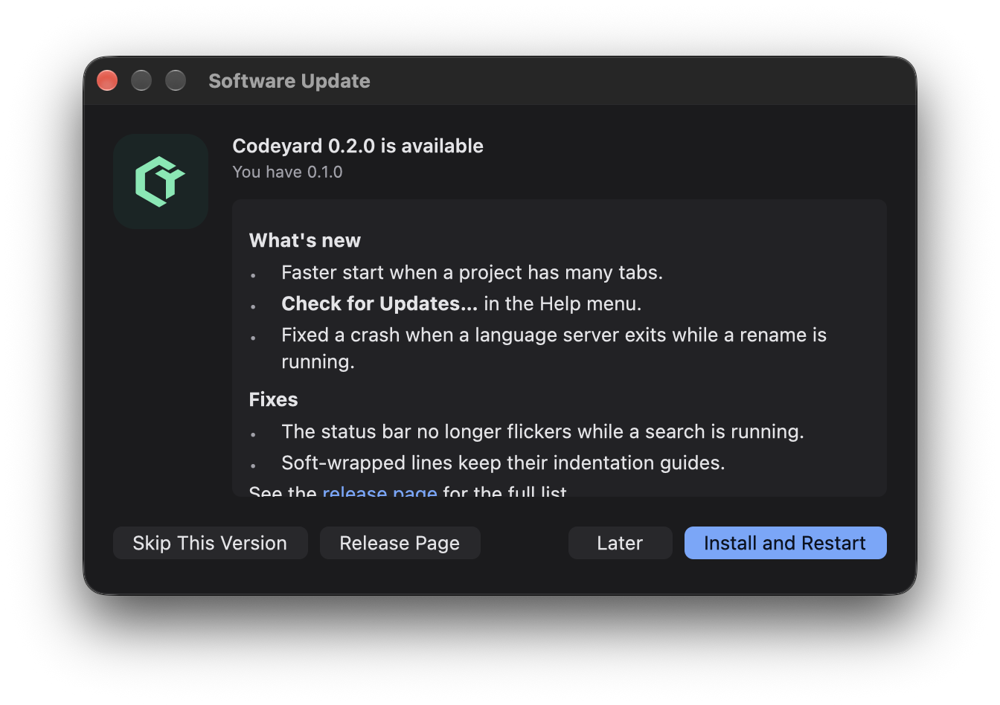

# User guide

Everything Codeyard does, by area. Key tables show macOS first; on Linux and Windows `⌘` is Ctrl and `⌥` is Alt unless a row says
otherwise (Windows is released, Linux is not yet; see [platforms.md](platforms.md)). The in-app *Help: Keyboard Shortcuts Reference*
is the complete list and always matches your key bindings; every setting is in [settings.md](settings.md).

<!-- toc -->
- [Keys](#keys)
- [Welcome, Settings page and customization](#welcome-settings-page-and-customization)
- [Source control, Timeline and more](#source-control-timeline-and-more)
- [Settings and keyboard shortcuts](#settings-and-keyboard-shortcuts)
- [Interface scale](#interface-scale)
- [Interface language](#interface-language)
- [Updates](#updates)
- [Themes](#themes)
- [Extensions](#extensions)
- [Git](#git)
- [Projects, favorites, bookmarks, tasks](#projects-favorites-bookmarks-tasks)
- [Highlighting, diffs and crash reports](#highlighting-diffs-and-crash-reports)
- [Debugging](#debugging)
- [Testing](#testing)
- [Workspaces with several folders](#workspaces-with-several-folders)
- [Language servers](#language-servers)
- [Working in Rust](#working-in-rust)
- [JSON and YAML schemas](#json-and-yaml-schemas)
- [Data tools](#data-tools)
- [Colours](#colours)
- [Spell check](#spell-check)
- [Merge editor](#merge-editor)
- [Compare folders](#compare-folders)
- [GitHub pull requests](#github-pull-requests)
- [HTTP files](#http-files)
- [Terminal](#terminal)
- [Port forwarding](#port-forwarding)
- [Remote (SSH)](#remote-ssh)
<!-- /toc -->

## Keys

| | macOS | Linux / Windows |
| --- | --- | --- |
| Go to file | ⌘P | Ctrl+P |
| Command palette | ⇧⌘P | Ctrl+Shift+P |
| Go to line | ⌃G | Ctrl+G |
| Color theme | ⌘K ⌘T | Ctrl+K Ctrl+T |
| Toggle sidebar | ⌘B | Ctrl+B |
| Find / replace in file | ⌘F / ⌥⌘F | Ctrl+F / Ctrl+H |
| Next / previous match | ↵ / ⇧↵, ⌘G / ⇧⌘G | Enter / Shift+Enter, F3 / Shift+F3 |
| Match case / whole word / regex / preserve case (replace) | ⌥C / ⌥W / ⌥R / ⌥P | Alt+C / Alt+W / Alt+R / Alt+P |
| Replace all | ⌥⌘↵ | Ctrl+Alt+Enter |
| Find in selection / select all matches (find bar) | ⌥⌘L / ⌥↵ | Ctrl+Alt+L / Alt+Enter |
| Find in files | ⇧⌘F | Ctrl+Shift+F |
| Structural search (replace: from the palette) | ⌥⇧⌘F | Ctrl+Alt+Shift+F |
| Split editor (same file in a new group) | ⌘\ | Ctrl+\ |
| Move tab to the other group | ⌃⌘→ / ⌃⌘← | Ctrl+Ctrl+→ (rebind) |
| Focus left / right group | ⌘1 / ⌘2 | Ctrl+1 / Ctrl+2 |
| Source control | ⌃⇧G | Ctrl+Shift+G |
| Problems | ⇧⌘M | Ctrl+Shift+M |
| Go to definition | F12 or ⌘-click | F12 or Ctrl+click |
| Suggestions / hover | ⌃Space / ⌘K ⌘I | Ctrl+Space / Ctrl+K Ctrl+I |
| Next / previous change (diff) | F7 / ⇧F7 | F7 / Shift+F7 |
| Word left / right (+Shift selects) | ⌥← / ⌥→ | Ctrl+← / Ctrl+→ |
| Delete word left / right | ⌥⌫ / ⌥⌦ | Ctrl+Backspace / Ctrl+Delete |
| Select word / line | double / triple click | double / triple click |
| Add cursor (click) | ⌥-click | Alt+click |
| Add cursor above / below | ⌥⌘↑ / ⌥⌘↓ | Ctrl+Alt+↑ / Ctrl+Alt+↓ |
| Select next occurrence | ⌘D | Ctrl+D |
| Back to one cursor | Esc | Esc |
| Terminal / new terminal | ⌃\` / ⌃⇧\` | Ctrl+\` / Ctrl+Shift+\` |
| Terminal copy / paste | ⌘C / ⌘V | Ctrl+Shift+C / Ctrl+Shift+V; Ctrl+C copies a selection or sends SIGINT |
| Terminal find / clear / select all | ⌘F / ⌘K / ⌘A | Ctrl+Shift+F / Ctrl+Shift+K / Ctrl+Shift+A |
| Toggle bottom panel (opens a terminal if none) | ⌘J | Ctrl+J |
| Rename / delete (file tree) | F2 / ⌘⌫ | F2 / Ctrl+Backspace |
| Toggle line comment | ⌘/ | Ctrl+/ |
| Indent / outdent lines | Tab / ⇧Tab (with a selection) | Tab / Shift+Tab |
| Move lines up / down | ⌥↑ / ⌥↓ | Alt+↑ / Alt+↓ |
| Copy lines up / down | ⇧⌥↑ / ⇧⌥↓ | Shift+Alt+↑ / Shift+Alt+↓ |
| Delete line / select line | ⇧⌘K / ⌘L | Ctrl+Shift+K / Ctrl+L |
| Rename symbol | F2 | F2 |
| Find references | ⇧F12 | Shift+F12 |
| Go to symbol in file | ⇧⌘O | Ctrl+Shift+O |
| Go to symbol in workspace (or `#` in ⌘P) | ⌘T | Ctrl+T |
| Quick fix | ⌘. | Ctrl+. |
| Format document | ⇧⌥F | Shift+Alt+F |
| Save all | ⌥⌘S | Ctrl+Alt+S |
| Interface zoom in / out / reset to 100% | ⌘= / ⌘- / ⌘0 | Ctrl+= / Ctrl+- / Ctrl+0 |
| Back / forward | ⌃- / ⌃⇧- | Ctrl+Alt+- / Ctrl+Shift+- |
| Reopen closed tab | ⇧⌘T | Ctrl+Shift+T |
| New file / save as / new window | ⌘N / ⇧⌘S / ⇧⌘N | Ctrl+N / Ctrl+Shift+S / Ctrl+Shift+N |
| Word wrap | ⌥Z | Alt+Z |
| Fold / unfold / fold all / unfold all | ⌥⌘[ / ⌥⌘] / ⌘K ⌘0 / ⌘K ⌘J | Ctrl+Alt+[ / ] / Ctrl+K Ctrl+0 / J |
| Select all occurrences | ⇧⌘L | Ctrl+Shift+L |
| Expand / shrink selection | ⌃⇧⌘→ / ⌃⇧⌘← | (rebind) |
| Join lines | ⌃J | Ctrl+J |
| Next / previous problem | F8 / ⇧F8 | F8 / Shift+F8 |
| Go to implementations | ⌘F12 | Ctrl+F12 |
| Switch project | ⌃R | Ctrl+R |
| Run build task | ⇧⌘B | Ctrl+Shift+B |
| Start / continue debugging, stop, restart | F5, ⇧F5, ⇧⌘F5 | F5, Shift+F5, Ctrl+Shift+F5 |
| Run without debugging | ⌃F5 | Ctrl+F5 |
| Toggle breakpoint (or click the gutter) | F9 | F9 |
| Step over / into / out | F10, F11, ⇧F11 | F10, Ctrl+F11, Shift+F11 |
| Pause the program | F6 | F6 |
| Terminal: previous / next command (shell integration) | ⌘↑ / ⌘↓ | Ctrl+Shift+↑ / ↓ |
| Split terminal (in the terminal) | ⌘\ | Ctrl+Shift+5 |
| Next / previous terminal (in the terminal) | ⇧⌘] / ⇧⌘[ | Ctrl+Shift+] / Ctrl+Shift+[ |
| Run and Debug view | ⌃⇧D | Alt+Shift+D |
| Toggle bookmark / next / previous | ⌥⌘K / ⌥⌘L / ⌥⌘J | Ctrl+Alt+K / L / J |
| Cut / copy / paste in the file tree | ⌘X / ⌘C / ⌘V | Ctrl+X / Ctrl+C / Ctrl+V |
| Switch editor (open files, last used first) | ⌘E | Ctrl+E |
| Zen mode / full screen | ⌘K Z / ⌃⌘F | Ctrl+K Z / F11 |
| Duplicate selection (or line) | ⇧⌘D | Ctrl+Shift+D |
| Transpose characters | ⌃T | (palette) |
| Type in the file tree to jump to a name | letters | letters |
| Settings (UI page) | ⌘, | Ctrl+, |
| Markdown preview | ⇧⌘V | Ctrl+Shift+V |
| Next / previous search result | F4 / ⇧F4 | F4 / Shift+F4 |
| Search Editor: run the search again | ⇧⌘R | Ctrl+Shift+R |
| Search Editor results: move / open or fold / select a change | ↑ ↓ / ↵ / Space | ↑ ↓ / Enter / Space |
| Toggle block comment | ⇧⌥A | Shift+Alt+A |
| Go to last edit location | ⌘K ⌘Q | Ctrl+K Ctrl+Q |
| Open / close everything inside a folder (file tree) | ⇧→ / ⇧← | Shift+→ / Shift+← |
| Expand snippet / next tab stop / previous | Tab / Tab / ⇧Tab | Tab / Tab / Shift+Tab |
| Context menu of the focused row, the Explorer selection or the editor | ⇧F10 | Shift+F10, Menu key |
| Run and Debug, Testing, Remote Explorer and Ports lists: move / first / last / open | ↑ ↓ / Home / End / ↵ | ↑ ↓ / Home / End / Enter |

The lists of the Run and Debug view (variables, watches, call stack, breakpoints), the Testing view, the Remote
Explorer and the Ports panel take the keyboard as a whole: Tab reaches them (a click on a row does too), a frame in the
focus colour marks the list and the row under the cursor, and Enter does what a click on the row does. Shift+F10 (or the
Menu key on Windows keyboards) opens the menu a right click opens, under the row; Escape closes it and the keyboard goes
back to the row. The same key opens the Explorer's menu for the selected row and the editor's menu at the caret. The
keys are commands like any other (`rows.previous`, `rows.next`, `rows.first`, `rows.last`, `rows.activate`,
`list.showContextMenu`), so `keybindings.jsonc` can change them.

Right-click in the file tree for new file/folder, cut/copy/paste, rename, delete, copy path,
favorites. Drag files and folders onto a folder to move them (an existing file is never
overwritten). Deleting a local file moves it to the Trash (`"files.enableTrash": false` deletes
permanently; on SSH hosts there is no Trash, so it asks). Right-click a tab for close others /
to the right / saved, pin, copy path; drag tabs to reorder them or onto the other group.
Right-click in the editor for go to definition / references, rename, cut/copy/paste,
file history and blame. A single click in the tree opens a preview tab (italic) that the next
preview replaces; editing or double-clicking keeps it. Tabs of files with the same name show
the folder that tells them apart; the breadcrumbs above the editor reveal a folder in the tree.

**Explorer.** Vertical guides under every folder arrow show the hierarchy; the guide of the
selected folder is highlighted. Folders that only hold one folder show as one row
(`src/main/java`, `"explorer.compactFolders"`). `"explorer.sortOrder"` is `default` (folders
first), `filesFirst`, `mixed` or `type` (by extension). Type letters with the tree focused to
jump to the next name that starts with them. OPEN EDITORS lists the open files above the tree
(click to switch, × to close, a dot when unsaved; `"explorer.openEditors": false` hides it).
Right-click also has Duplicate, Open to the Side, Select for Compare / Compare with Selected
(two files side by side) and Open in Integrated Terminal (in that folder).

**Selecting several entries.** Cmd-click (Ctrl-click on Windows/Linux) toggles an entry;
Shift-click selects a range. Shift+Up/Down, Shift+Home/End and Shift+PageUp/PageDown extend
the selection, Cmd+A (Ctrl+A) selects the visible entries and Cmd+Space (Ctrl+Space) toggles
the focused entry. Sorting and refresh keep the selected paths; collapsing a folder removes
its hidden children from the selection. A selection belongs to one workspace tree at a time.

Copy, cut, drag and delete apply to the selection, including from the context menu. Selecting
a folder and its children processes the folder once. Batches show one confirmation with the
count, destination and source paths; the complete list and failures are in Output. Existing
targets are never overwritten: copies choose a numbered name, moves report the conflict and
leave the failed cut entries on the clipboard for retry. Successful moves update open tabs;
deleting files keeps their unsaved buffers open. A failed Trash operation never escalates to
permanent batch deletion. The status bar shows progress; cancellation interrupts an active copy and stops before the next move or deletion;
the palette also has *File: Cancel File Operation*. Closing/changing the workspace invalidates
pending confirmations and stops the remaining entries. Copies stream on the file's host,
preserve symlinks and executable permissions, and publish each completed entry atomically.
One directory copy is limited to 100,000 entries and 128 nested levels; a limit or I/O failure
removes its staged contents. Copying never needs `cp` or a shell. A lost connection or unconfirmed cancellation stops the batch and reports that the outcome needs inspection before retrying.

**Editor.** `"editor.rulers": [80, 120]` draws vertical rulers; `"editor.renderWhitespace"`
(`none`, `boundary`, `all`) marks spaces and tabs; `"editor.lineNumbers"` is `on`, `off` or
`relative`; `"editor.cursorStyle"` is `line`, `block` or `underline`. Matching brackets are
colored by nesting depth (`"editor.bracketPairColorization"`), a bar under `#rrggbb` shows the
color (`"editor.colorDecorators"`), and while you scroll inside a function or class its header
lines stay pinned at the top (`"editor.stickyScroll.enabled"`; click one to jump there).
Palette commands: Transform to Title Case, Duplicate Selection, Trim Trailing Whitespace,
Transpose Characters, Reverse Lines, Delete Duplicate Lines, "Search: Find TODO Comments"
(TODO, FIXME, HACK, XXX, BUG), "View: Switch Editor…" and "View: Toggle Zen Mode".

The cursor blinks for a few seconds after you stop typing, then stays solid: an idle window
draws nothing, so the GPU gives its frame buffers back (about 110 MB on a Retina Mac).
`"editor.cursorBlinking": "solid"` turns blinking off.

In the terminal, ⌘-click (Ctrl+click) a URL or a location such as `src/main.rs:12:5`,
`app.ts(3,7)` or a Node stack line to open it (relative paths are taken from the project
folder); holding ⌘ underlines what can be opened. Drag to select, double-click for a word, triple-click for a line, Shift+click
to extend; ⌘C copies. On keyboard layouts without a reachable \` key (Turkish Q, German),
use ⌘J or bind `terminal.toggle` yourself (below).

Opening a file from Explorer or Quick Open restores a maximized terminal panel to its previous size and shows the editor.

**Arranging views.** "View: Move View to Secondary Side Bar" moves the open side view (Explorer, Search, Source
Control, Run and Debug, Testing, Remote, Extensions) to a second side bar on the right of the editor; its activity bar
icon and commands then open it there, next to whatever the left side bar shows. "View: Move View to Primary Side Bar"
moves it back and "View: Toggle Secondary Side Bar" hides or shows it; the arrangement comes back at the next start.
You can also drag a view's activity bar icon to the other side: while you drag, the left and right edges of the window
show a highlighted drop zone, and the view opens in the side bar you drop it on. The panel (terminal, Problems,
Output) docks below the editor or beside it: "View: Move Panel Left", "View: Move Panel Right" and "View: Move Panel
to Bottom" (or the button in the panel's header); a panel docked beside the editor is resized from its edge towards the
editor, and the dock is kept for the next start. Screen readers read which view each side bar shows and where the panel
is in the window's description. Drag an editor tab out of the window and release it outside: over another Codeyard
window, the file opens there and its tab here closes (a file with unsaved changes, or one on another machine than that
window's folder, stays where it is and the status bar says why); anywhere else, the tab becomes a window of its own at
that place, showing the same document (as "View: Move Editor into New Window" does).
"View: Move View into New Window" moves the open side view (Explorer, Search, Source Control, Run and Debug, Testing,
Remote Explorer, Extensions) into a window of its own, for example on another display. It is the same view: what you
select, expand or type there is what the side bar would have shown. Its activity bar icon and commands then bring that
window to the front instead of opening it in a side bar; the command palette, shortcuts, its right-click menus and
pickers work in that window. Closing the window, ⌘W in it, or "View: Move View Back to Side Bar" puts the view back in
the side bar it came from. The windows belong to the folder: they are saved with it, close when the folder or the
connection changes (their views going back to the side bars), and come back when the folder opens again, on an
attached display. Screen readers find the view in its own window, named after the view. A code extension's side bar
view moves the same way (and to the secondary side bar): it stays the same view, so what the extension draws reaches
the window and what you do there goes to the extension. Its window comes back only while the extension is installed;
it closes when you remove or turn off the extension, and the view returns to the side bar if the extension crashes.
"Terminal: Move Terminal into New Window" moves the active terminal, with its running program, into a window of its own
(the same terminal, not a copy). Closing that window puts the terminal back in the panel, still running;
"Terminal: Move Terminals Back to Panel" does it for all of them. A detached terminal belongs to its editor window and
ends with it, or when the connection changes. "Terminal: Move Terminal into Editor Area" moves the active terminal into
the focused editor group as a tab, next to your files; "Terminal: Move Terminal Back to Panel" returns it, and so does
closing its tab (closing a terminal's tab never ends what runs in it). Opening another folder also returns
it to the panel; a connection change ends it like a panel terminal. Drag a terminal's tab onto another group's tab bar
to move it there; screen readers list terminal tabs with the other tabs of the focused group, and selecting one brings it
to the front. At the next start, each terminal that was in an editor group or in a window of its own comes back in the
same place as a new shell, with its name, colour and folder, and the line "Previous session ended; started a new
shell"; nothing from the previous session runs again. A window whose display is gone opens on an attached display, made
to fit; a saved arrangement that cannot be read is ignored.

"View: Move Editor into New Window" shows the active file in a window of its own, for example on a second display;
"View: Copy Editor into New Window" does the same and keeps its tab. Both windows show one document: what you type in
one appears in the other at once, undo takes back edits made in either, and one save writes it. Each window keeps its
own cursor, selection, scroll and find bar. Completion, hover, diagnostics and go to definition work there as in a tab
(a definition in another file opens in the main window). Closing the file's window puts it back as a tab of the focused
group with any unsaved changes; ⌘W in it closes the file instead, and asks whether to save when no other tab or window
shows it. "View: Move Editors Back to Main Window" returns all of them. The windows belong to their folder: they close
when the folder or the connection changes or the main window closes (unsaved changes are kept by hot exit or asked
about, as for tabs), and come back in place at the next start; a file you also open as a tab keeps its tab. In a file's
own window the command palette, Quick Open, Go to Line, the right-click menu and the other commands and shortcuts work
as in the main window and act on that window's editor; a command that shows something in the main window (another
file, a side view) brings it to the front. Screen readers see the editor in its own window, and the terminal in its
own window, the same way as in the main window.
**Terminals after a restart.** With `window.restoreSession` on (the default), a folder's terminals come back when the
folder opens again: the panel's in the same order, and those you moved into an editor group or a window of their own in
those places, with the same folder, title, color and program. Their shells keep running when you are expected to come
back: when you **quit** Codeyard (⌘Q, Quit in the menu, an update's restart), or when it crashes or is killed. A local
folder's terminals run in a small background process of Codeyard's (the terminal daemon); an SSH
folder's already run in Codeyard's agent on the server. Leaving on purpose ends them at once, as always: **closing the
window** (even the last one), *Close Folder*, opening another folder in the window or connecting elsewhere. Open the
folder again within `terminal.persistentSessionTimeout` minutes (5 by default, at most 1440; 0 keeps nothing) and you get
**the same shells back**, still running, with what they printed meanwhile and a line *Reconnected to terminal session*
(also announced in the status bar). If another Codeyard instance already has a local folder's terminals open, they stay
with it: this window starts new shells and says so in the status bar. If more than the last 256 KB of a terminal's output
came while no window was open, the line says how much was lost. A terminal no window takes back in time is ended; the
local daemon stops 10 minutes after its last terminal. Any terminal that cannot be taken back (it ended, the daemon or
the server was restarted, `window.restoreSession` is off) is a **new shell**: nothing that
ran before is started or typed again, and a line says *Previous session ended; started a new shell*. If a terminal's folder is gone,
it starts in the workspace folder and says so. `"terminal.persistentScrollback": 1000` also keeps the last lines of each
terminal's history (plain text, with colors and control sequences removed) and shows them above that line; it is 0 (off) by
default, because history can contain secrets. "Terminal: Clear Saved Terminal History" removes the saved history now.
Environment variables from terminal profiles are not saved. Task and test output terminals are not restored. Over SSH, a
dropped connection reconnects to the shells that are still running on the server (they are not restarted).

Terminal line editing works as in Terminal.app: ⌘← / ⌘→ jump to the start / end of the line, ⌥← / ⌥→ move by word,
⌘⌫ deletes to the start of the line, ⌘⌦ to its end and ⌥⌦ the next word (these are the shell's own keys, Ctrl+A, Ctrl+E,
Esc b…, so they work in bash, zsh and fish; full-screen programs such as vim get the plain keys). ⌘F finds in the output and
the scrollback: every match is tinted, ↵ steps to the previous one, ⌘G / ⇧⌘G to the next / previous (F3 / Shift+F3 on Linux and
Windows) and Esc closes. ⇧PageUp / ⇧PageDown scroll a page, ⌘Home / ⌘End (Ctrl+Shift+Home / End) jump to the top or bottom.
Right-click for copy, paste, select all, find and clear; the Terminal menu has them too. Find with several cursors: copy gives one
line per cursor, and pasting the same number of lines puts one on each cursor.
On a Turkish Q layout ⌘/ is ⇧⌘7; if that is awkward, bind `editor.toggleComment` to
another key.

Brackets and quotes close themselves (typing over the closing one skips it; with a
selection they wrap it); turn off with `"editor.autoClosingBrackets": false`. Long lines
scroll sideways (trackpad or ⇧+wheel). The minimap on the right is on by default
(`"editor.minimap.enabled": false` hides it); click or drag it to jump.

**Folding** is by indentation (works in every language): hover the gutter for the arrows.
Folds belong to the view, so groups displaying the same document can fold differently. **Word wrap**
breaks at spaces at the window edge; ↑↓ move by screen row. Sort lines, upper/lower case,
change line endings and indentation (click them in the status bar) are in the palette.
With the same file open in several groups, each group has its own cursors, scroll and find bar.
Edits and undo belong to the shared document.

**Editor groups** form a nested grid. ⌘\ (Ctrl+\ on Windows/Linux) adds a group to the right;
use **View: Split Editor Left**, **Up**, or **Down** in the command palette for the other directions.
Drag a divider to resize its two regions. Drag a tab within a group to reorder it, or onto another
group to move it; closing a group's last document removes the empty group. **View: Close Empty
Editor Group** also closes an explicitly opened empty group and cancels its pending file opening.
The final group remains available for opening files.

⌘1/⌘2 (Ctrl+1/Ctrl+2) focus the neighboring left/right group. The palette also provides **View:
Focus Upper Editor Group** and **View: Focus Lower Editor Group**; all commands can be rebound
in Keyboard Shortcuts. A window supports up to 32 groups. Minimum pane dimensions keep tabs and
text usable; the grid scrolls when it cannot fit, and focusing a group brings it into view.
With session restoration enabled, the grid, ratios, focused group, tab order, primary cursors and
scroll positions return when the workspace reopens, including empty groups. Existing two-group
sessions migrate automatically. Welcome/settings/diff/preview tabs stay in their owning group
while switching focus; session restoration currently saves text-document tabs and empty groups.

**Images** (png, jpg, gif, webp, svg, bmp) open in a preview tab.

**Find in files** (⇧⌘F) has a replace field. "Replace All" (or ↵ in the field, or "replace in
this file" on a result) does not write anything: it opens a Search Editor with a replacement
preview, described below.

### Search Editors and replacement review

"Search: Open Search Editor" (or the page icon in the Search panel's results bar) keeps the current
query in an editor tab of its own. Each tab remembers its query, the match case / whole word /
regex options, the include and exclude globs, the replacement, how many context lines to show
(the − / + buttons, 0–5) and the host and folders it searched. Several Search Editors can be open
at once; the Search panel stays free for other queries.

- **Navigate.** Click a match, or focus the list and use ↑ / ↓ and ↵; F4 / ⇧F4 step through the
  matches. Context lines are read for the first 2000 matches. "Rerun" (⇧⌘R) searches again in
  the same tab. In a workspace with several folders every folder is searched, as in the Search
  panel; files of other folders show as `folder › path`. A tab whose folders are no longer all in
  the workspace is marked stale.
- **Bounded.** A tab keeps at most 20000 matches in 5000 files. When the search stops at the
  result limit (`"search.maxResults"`), is stopped or fails, the tab says the results are
  incomplete.
- **Restart.** Search Editors come back with the workspace, with their query and up to 200
  results each, marked "Restored from the last session". Nothing runs and nothing is replaced
  until you rerun. A tab whose host or folder is not the one the window shows says so and cannot
  open, preview or replace anything there.
- **Preview.** "Preview Replace" (or ↵ in the replacement field) lists every change as the line
  before and after, with a checkbox per change and per file (Space toggles the focused row).
  The plan is made from the current text of each file: an open editor's unsaved text wins over
  the disk. Nothing is written before "Apply 3 changes in 2 files" (the button counts the selected
  changes and files).
- **Apply.** Apply is refused while the results are incomplete or out of date ("Search results
  are incomplete; rerun before replacing."). Open files change in their editors, one undo step
  each, and are not saved. Closed files are written one at a time, each atomically and only if it
  is still exactly what the preview read; otherwise it is left alone and reported as "File
  changed since preview". Every file keeps its encoding (UTF-8 with or without a byte-order mark,
  UTF-16, Windows-1254, ISO 8859-9, ISO 8859-1), its line endings, mixed ones included, and a
  missing final newline; a file whose encoding cannot hold the replacement, or that would not be
  written back byte for byte, is listed and not changed. Binary files are never changed. This is
  not a multi-file transaction: the report lists what changed, what did not and why, and any file
  whose outcome is unknown (for example when the connection drops), with no automatic retry.
- **Replacement text.** In regex mode `$1`, `${name}`, `$&` and `\n` work as in the find bar;
  line breaks become the file's line ending. Matching is per line, as in the search, and empty
  matches (`^`, `\b`, `x*` where there is no `x`) are never replaced. "Preserve case" follows
  each match's letter case.
- **Undo.** "Undo Replace" in the tab, or "Search: Undo Last Replace", takes the whole batch back
  once: open editors lose that one step, files get their previous bytes. A file or editor
  changed since the replacement, or reopened with unsaved edits, is reported as an undo conflict
  and kept as it is.

Search Editors work the same on SSH hosts: the host searches, reads and writes the files.

### Structural search and replace

"Search: Structural Search…" (⌥⇧⌘F) and "Search: Structural Replace…" open the Search panel in structural mode; the `$X` button in
the search box switches it on and off. The pattern is code in a language you pick (the chip next to the field; a click goes to
the next one; it starts as the language of the active file, and a selection becomes the pattern). It is matched against the
syntax tree, so spacing, line breaks and comments inside the code do not matter, and a match can span several lines.

- `$X` matches one node: an identifier, a call, a whole block. A name used twice (`$X == $X`) must match the same text both times.
- `$$$X` matches zero or more neighbouring nodes, for example all the arguments or all the statements of a block.
- Names are upper case (`$X`, `$ARGS_2`). A name that starts with `_` (and `$_`, `$$$`) matches without remembering. `$x`, a lone
  `$` and `$$` are ordinary text, so shell and PHP variables can be written as they are.
- Everything else must be the same code. A `;` at the end may be left out. Comments are ignored unless the pattern has one.
- A pattern is one expression or statement (or item, or type), not a sequence of them. In Python and Go a block is easiest written
  on one line, or with ⇧↵ in the field. Rust macro arguments are plain tokens: use `$$$` for them.
- If the pattern does not parse, the parser's position is shown under the field and nothing runs.

Results list like any search (file, line, preview), with "replace in this file" and "dismiss" on each file. The replacement field
takes `$X` and `$$$X` of the pattern; any other `$name` stays as typed. "Replace All" asks first, like Replace in Files: open files
change in their editors (one undo step), closed files are written to disk and keep their line endings. Matches inside other matches
(`f(f(1))`) are changed outermost first; search again for the inner ones. If a replacement would leave a file that no longer parses, the
prompt names it and offers to skip it.

How it works and what it leaves out:

- The folder's text search first finds files that contain the longest word of the pattern; only those are read and parsed (`.gitignore`,
  `files.exclude` and `search.exclude` apply, and so do the include and exclude fields). Unsaved editor text is used instead of the
  file on disk. It works over SSH the same way: the server searches, this computer parses.
- Files over 2 MB, binary files, and files with syntax errors are skipped; the second line of the status says how many.
  `"search.structural.maxFiles"` (default 5000) caps how many files are parsed, and the status says when it did.
- Nothing from the folder is run, so it also works in untrusted workspaces, and nothing is written before you confirm.
- Languages: Rust, TypeScript, JavaScript, Python, Go, Java, C, C++, C#, Ruby, PHP, Kotlin, Swift, Lua and Shell. A TypeScript pattern
  also searches `.tsx`, a JavaScript one `.jsx`.

Six recipes (pattern → replacement):

1. Rust, avoid building the default when it is not needed: `$R.unwrap_or($X.clone())` → `$R.unwrap_or_else(|| $X.clone())`.
2. Python, compare with `None` the right way: `$X == None` → `$X is None`.
3. TypeScript, move console logging to a logger: `console.log($$$ARGS)` → `logger.debug($$$ARGS)`; `$$$ARGS` carries any number of arguments.
4. Go, switch the logging package: `fmt.Println($$$A)` → `log.Println($$$A)`.
5. Rust, change a type everywhere it is written: `Box<Vec<$T>>` → `Box<[$T]>`.
6. Rust, only look: `$X == $X` finds a value compared with itself, and `if $C { $$$B }` lists every `if`. Leave the replacement empty to search.

**Encodings:** UTF-8 (with or without BOM), UTF-16 with a BOM, and single-byte files.
A file that isn't valid UTF-8 is read as Windows-1254 (Turkish) by default; change it with
`"files.fallbackEncoding": "iso88599"` or `"iso88591"`. Files are saved in the encoding
they were opened with (shown in the status bar). If you type a character that encoding
can't hold, saving stops with a message instead of writing a broken file.

**Large files:** files over 32 MB open read-only, a few hundred lines at a time (the line
index lives in the agent), so a 500 MB log opens in about the memory of a small one.
⌃G works there too, and ⌘F searches the file on the machine where it is (it is never copied
over SSH); ↵ / ⇧↵ step through the matches.

**Suggestions without a language server:** after two letters, words from the file are
suggested (nearby words first); `"editor.wordBasedSuggestions": false` turns this off.

## Welcome, Settings page and customization

**Title bar (macOS).** The middle of the title bar holds back / forward and a search box with the folder name
(and the SSH host): click it to go to a file (⌘P). The sidebar is shown and hidden from the activity bar (or ⌘B).

**What opens at start** is a setting, `"window.startup"` (Settings ▸ Window):

- `"welcome"` (default): the **Welcome** screen. Start actions (new file, open folder, clone a
  repository, connect over SSH), your recent projects, customize links, the most useful shortcuts
  and a tip of the day. Nothing reconnects by itself, SSH hosts included.
- `"continue"`: like a browser, the last folder (or SSH host) and its tabs come back. If the folder is
  gone you land on the Welcome screen with a note.
- `"blank"`: an empty window with just the logo.

A folder or file given on the command line always opens, whatever the setting. An empty editor
shows the Welcome content unless the setting is `"blank"`; "Help: Welcome" opens it as a tab.
`"window.restoreSession"` is separate: it brings a folder's tabs and unsaved changes back whenever
you open that folder. Right-click the Dock icon (macOS) for New Window, Open Folder and your
recent projects; they are also under File ▸ Open Recent.

The gear at the bottom of the activity bar is one menu: **About Codeyard** (version), Settings,
Color Theme, File Icon Theme, Keyboard Shortcuts and the Command Palette.

**Settings** (⌘, or "Preferences: Open Settings") is a page with categories, search, switches,
option buttons and number fields; every change is written to `settings.jsonc` (comments stay)
and applies at once. A dot marks values that differ from the default, "Reset" removes them, and the **Modified** view lists them all.
"Preferences: Open Settings (JSON)" opens the file itself. The Uppercase / Lowercase / Title Case commands follow `editor.caseLocale`
(`auto`: Turkish `i`/`İ`, `ı`/`I` rules when the text contains ı İ ş ğ).
"Help: Keyboard Shortcuts Reference" lists every command with its keys (searchable, click to run).

Make it yours:

- **Colors:** pick one of 23 themes (the plain defaults Codeyard Dark and Codeyard Light, Codeyard One, Studio Dark, Midnight, Graphite, Ember, Fjord, Quarry,
  Dracula, One Dark, Nord, Solarized Dark/Light, GitHub Dark/Light, Catppuccin Mocha, Tokyo Night, Gruvbox Dark, Daylight, Paper, high contrast…),
  change single colors with `"workbench.colorCustomizations": { "accent": "#ff8800",
  "[Quarry]": { "syntax-string": "#a6e22e" } }` (roles are the names in the theme files; an
  entry in `[brackets]` applies to that theme only), or "Theme: Save Current Colors as User
  Theme…" to keep your tweaks as a theme file. VS Code color themes dropped into
  `~/.config/codeyard/themes` are imported.
- **Icons:** "Theme: Pick File Icon Theme…" previews Minimal (default), Codeyard, Language Badges,
  Colorful Folders, Apple / GitHub (solid blue folders, outline files with a language dot),
  Material (folders colored and marked by purpose, solid colored files) and None (`"workbench.iconTheme"`).
- **Layout:** `workbench.fontFamily` (UI font), `workbench.activityBar.visible`,
  `workbench.statusBar.visible`, `workbench.editor.showTabs`, `workbench.tabs.closeButton`,
  `workbench.tabs.showIcons`, `workbench.breadcrumbs.enabled`, `workbench.tree.indent`.
  Sidebar sections (Open Editors, Outline, Timeline, Graph…) fold when you click their title and
  resize when you drag their edge; the layout is remembered.
- **Editor:** `editor.cursorWidth`, `editor.renderLineHighlight`, `editor.matchBrackets`,
  `editor.folding`, `editor.hover.enabled`, `editor.quickSuggestions`, and
  `files.associations` (`{ "*.tpl": "html" }`) next to the options listed below.
- **Snippets:** type a prefix and press Tab (`fn`, `for`, `def`, `html5`…); "Snippets: Insert
  Snippet…" lists them. "Preferences: Configure User Snippets" opens
  `~/.config/codeyard/snippets/<language>.json` in the VS Code snippet format (`global.json`
  applies to every file).

## Source control, Timeline and more

**Graph.** Source Control shows the history of all branches as colored lanes (at most seven
columns), one line per commit: message, author and the most important branch/tag chip
(`"git.graph.showHash"` adds the short hash). Every row is only as wide as the branches running
next to it, so history reads from the left edge and side branches step to the right. Hover a commit
for its author, date, all labels and hash. Click a commit for its message, files and `+/−` counts below
the graph (click a file for its diff; double-click for the file list). Right-click for copy hash,
create branch or tag here, checkout (detached), cherry-pick, revert and reset (hard reset asks;
a cherry-pick or revert that conflicts is undone, never left half done; for a merge commit the first parent is the mainline).
There is no interactive rebase (squash, reorder, edit): use a terminal for that. The header searches
commits (message, author, hash, branch), fetches, pulls and pushes (with the counts of commits to pull
and to push) and reloads; its **…** menu picks the view (Graph, List with times, Days), the scope (all
branches or the current one), *Only My Commits* and *Hide Merge Commits*, and offers sync, pull
(rebase), push tags, checkout, new branch and new tag. Active filters show as chips under the header;
click one to turn it off. Stashes are listed with apply, pop and drop. `"git.graph.limit"`,
`"git.graph.allBranches"` and `"git.timeline.limit"` tune it; the Changes groups fold too.

**Explorer sections.** OPEN EDITORS, the folder tree, **OUTLINE** (functions, types and
headings of the open file, found without a language server) and **TIMELINE** (the file's git
commits plus a saved copy for every save, "local history"; click an entry for a diff).
Clicking the empty space under the tree clears the selection so new files go to the root; open
folders are remembered per project; ⇧→ / ⇧← (or the context menu) open or close everything
inside a folder. Right-click ▸ Find in Folder… limits the search to it.

**Search.** F4 / ⇧F4 step through the results; ↑ / ↓ in the field recall earlier queries;
the toolbar folds or opens all results and re-runs; each file has "replace in this file" and
"dismiss"; `"search.smartCase"`, `"search.exclude"`, `"search.collapseResults"`.

**Also new:** inline blame (who changed the cursor line, at its end; `"git.inlineBlame"`), Markdown
preview (⇧⌘V, live), compare with clipboard / with the saved file, run the selected text (or
line) in the terminal, last edit location, scratch files that need no folder, JSON format and
minify without a language server, camelCase / PascalCase / snake_case / kebab-case /
CONSTANT_CASE transforms, Base64 / URL / HTML encode and decode, more line sorts, insert date or
UUID, block comment toggle, recently used commands first in the palette,
"Git: Clone Repository…".

Markdown files (`.md`, `.markdown`) also have a **Read** button above the editor. In the
reading view, **Code**, Escape, or the preview shortcut returns to the source without
losing edits. Code blocks support syntax colors, horizontal scrolling and **Copy code**.
Heading links scroll within the document, with unique anchors for repeated or colliding
titles; relative file links open in Codeyard. Relative images load from the document's
own filesystem, including SSH hosts (up to 20 MB per
image, with the same 50-million-pixel limit as image tabs). External image URLs remain clickable links rather than loading automatically.
MDX components are not executed.

## Settings and keyboard shortcuts

`⇧⌘P` → "Preferences: Settings" lists the settings with their current values: pick one to
toggle it, choose from its options or type a value; it is written to `settings.jsonc` (your
comments stay) and applies at once. "Preferences: Keyboard Shortcuts" lists every command with
its keys; picking one adds a line for it to `keybindings.jsonc` and opens the file there.
"Preferences: Open Settings" / "Open Keyboard Shortcuts" open the files themselves:
`~/.config/codeyard/settings.jsonc` and `keybindings.jsonc` (comments and trailing commas are
fine). Changes apply on save; mistakes show in the status bar instead of being ignored.
A project can override settings in `.codeyard/settings.jsonc` (or `.vscode/settings.json`).

**Workspace Trust.** A folder you open can carry settings, tasks and debug configurations that run
programs. Until you trust a folder, its project settings cannot set `terminal.shell`, `lsp.servers` or schema
associations (the status bar says which keys were ignored), **language servers do not start** (a notice says so once;
they can run the project's build scripts), `$schema` addresses are only downloaded from SchemaStore, and running a task,
a test or the debugger first asks "Do you trust the authors of this folder?". A repository whose own Git settings name a
program (a filter, diff or merge driver, an ssh or credential command, a hooks folder) gets **no Git at all** until it is
trusted: `git status` alone would run its filters. A notice names the settings. Folders you had already opened before this
rule existed are trusted once. Trusting is remembered per folder (per host over SSH) and starts the language servers at once;
`Workspace: Trust This Folder` does it without a question. `security.workspaceTrust.enabled: false`
in your own `settings.jsonc` turns the check off; a project file can never change that key.

```jsonc
{
  "theme": "studio-dark",              // or "auto"; see Themes for the ids
  "editor.fontSize": 14,
  "editor.tabSize": 4, "editor.insertSpaces": true,
  "files.autoSave": "afterDelay",      // "off", "afterDelay", "onFocusChange"
  "files.trimTrailingWhitespace": true,
  "files.exclude": ["**/node_modules"],
  "terminal.shell": "/bin/zsh",
  "window.startup": "welcome",         // or "continue", "blank"
  "window.restoreSession": true
}
```

```jsonc
[
  { "key": "ctrl-ö", "command": "terminal.toggle" },
  { "key": "cmd-d", "command": null }   // unbind
]
```

Unknown command ids get a "did you mean" hint. Coming from VS Code? ⇧⌘P → "Preferences:
Import VS Code Settings and Shortcuts" copies the settings that have an equivalent here and
your shortcuts (into a marked block of `keybindings.jsonc`, so importing again replaces it);
it reports what had no equivalent. Your VS Code files are only read. Open tabs, cursors and unsaved changes are
restored on the next start (hot exit).

## Interface scale

*View: Zoom In* (⌘= or ⌘+), *Zoom Out* (⌘-) and *Reset Zoom* (⌘0; Ctrl on Windows), also in the View menu, make the
whole interface larger or smaller: menus, the activity bar, side bars, tabs, the editor, the terminal, dialogs, tooltips
and the status bar together. The steps are 75%, 80%, then every 10% from 90% to 200%; Reset Zoom returns to 100%. The
status bar shows the new value ("Interface scale: 110%").

Each change is saved as `ui.scale` in your own `settings.jsonc` (0.75–2, default 1) and applies at once to every open
window and after a restart. You can also type a value there or in *Preferences: Settings*, such as `1.25` (it is rounded to whole
percent); Zoom In and Zoom Out then continue from the next step. If the settings file cannot be written (no settings
folder, a read-only folder), the zoom still applies for the session and a settings reload keeps it, until the file's
own `ui.scale` changes. A value that is not a number from 0.75 to 2 is ignored with the message
"Interface scale must be between 75% and 200%." and the interface stays at 100%. A project's `.codeyard/settings.jsonc`
cannot set it.

`editor.fontSize` and `terminal.fontSize` stay the sizes you chose: at 150% a 14 pt editor font is drawn 1.5 times as
large, once, together with the rest of the window. The display's own scale (Retina, Windows display scaling) is applied
separately, so moving a window to another monitor keeps the chosen interface scale. Window sizes and the minimum window
size are in screen points and do not change when you zoom; when a small window cannot show every activity bar button,
the buttons scroll, a small chevron at the top or bottom edge shows that more are hidden, and the Manage button stays at
the bottom.

## Interface language

The interface is English; **Turkish (`tr`)** is the first translation. The setting `"ui.language"` (your own `settings.jsonc` only,
a project file cannot change it; also on the Settings page) takes `"auto"` (default), `"en"` or `"tr"`:

- `auto` follows the system language: on macOS the first supported language of System Settings ▸ Language & Region, on Windows
  the user's locale, elsewhere `LC_ALL`, `LC_MESSAGES`, `LANG` and `LANGUAGE` in that order. A system language without a translation
  (or no information at all) gives English. Note: `editor.caseLocale` is a separate setting (it only affects the case commands).
- The language is applied when the settings load and **at once when you change the setting**, no restart: the macOS menu bar and Dock
  menu are rebuilt, the other surfaces read the language every time they are drawn. A palette or dialog that is already open keeps
  the language it was opened with.

**What is translated.** Everything the program itself writes: the application menus (macOS menu bar and Dock menu, the in-window menu bar
on Windows and Linux), every command in the palette, the Welcome screen, the status bar, the editor and its context menus, the find
bar and popups, Source Control and its menus, the Explorer, Search, Problems and the bottom panels, the pickers, the Settings and
Keyboard Shortcuts pages (including the description of every setting), prompts, notices and error messages, confirmation dialogs
(unsaved changes, delete, replace in files, folder trust, transfers, Git), SSH hosts and port forwarding, the debugger, `.http`
requests, GitHub pull requests and the About dialog. The palette finds a command by its translated **or** its English label
(`file: new file` finds "Dosya: Yeni Dosya…"; Turkish letters match their plain forms, `gorunum` finds "Görünüm").

**What stays English**, on purpose:

- command ids, key bindings, setting names and the values in `settings.jsonc`, and everything that is data: file, folder, branch and
  author names, commit messages, language names, shell commands in install hints (`npm i -g …`) and task labels (`test: name`), which
  double as identifiers;
- text written by other programs and shown inside a Codeyard message unchanged: `git`, `ssh`, `curl`, language servers, debug adapters,
  the operating system; HTTP reason phrases ("Not Found"); the lines in the Output panel; the crash report file;
- the Alt+letter menu shortcuts on Windows and Linux (Alt+F opens "Dosya") and the items the system adds to its own menus
  (macOS Services, Window and Edit extras), which follow the system language;
- the documentation.

Warnings about the settings file are produced while it loads, so right after a language change the first reload may still show them in
the previous language. A string that bypasses the translation system is a bug: a test fails when user-visible text is not wrapped, so new
text arrives translated (see [translating.md](translating.md)).

**Adding or improving a language.** Translations are plain text files compiled into the binary (`crates/app/locales/<code>.tsv`, no new
dependency). The format, plurals, quality bar, the template file and the commands that show coverage are in
[translating.md](translating.md). A missing entry is never an error at run time: that string simply stays English.

## Updates

Codeyard can tell you when a new version is out and install it for you. It never looks on its own unless you said so.



**What is checked.** A check downloads two small files from the project's GitHub releases: the checksum list `SHA256SUMS.txt` and its
signature. github.com answers each request with a redirect to GitHub's release download host (`release-assets.githubusercontent.com`).
When the list names a newer version a third file follows, the release notes, and the installer when you choose to install. GitHub
sees your IP address and that the request comes from `curl`. No cookies are kept, no account or identifier is in the address, and
nothing about you, your files or your machine is sent beyond what any web request carries.

**What it does not do.** Codeyard never installs anything without your confirmation, and an update that Codeyard installs does not go
through macOS's first-launch check (Gatekeeper), because the files come from `curl` and Codeyard builds are not notarized yet. What
protects you instead is the signed checksum list (see *How it is verified*).

**When.** The setting `"update.check"` (your own `settings.jsonc` or the Settings page; a folder's `.codeyard/settings.jsonc` cannot
set it) takes:

| Value | What happens |
| --- | --- |
| `ask` (default) | Nothing is checked. A few seconds after the first window opens, once, Codeyard asks whether to check daily. *Check Daily* and *Only When I Ask* write `daily` or `manual` for you; closing the question with Esc writes nothing and asks again after 30 days. |
| `daily` | Looks when Codeyard starts and then once in 24 hours while it runs (one successful check a day). If a check fails, for instance offline, it is tried again every three hours while Codeyard runs, but after three failed attempts in a day it waits for the next day. A newer version shows one notice and an item at the right end of the status bar; a failed check is only logged to stderr. |
| `manual` | Only **Help ▸ Check for Updates…** (palette: *Help: Check for Updates…*; on macOS also under the *codeyard* menu) looks. |

That command works whatever the setting says, and shows its errors. Debug builds and windows started with `--do` or `--panel` never
ask and never check by themselves.

**The dialog.** On macOS it is a window of its own, titled *Software Update*, with the app's icon, like the update windows of other Mac
apps (other systems draw it as a card over the editor). Closing it with the red button, ⌘W or Esc does what *Later* does. *Checking*, then either "Codeyard is up to date" or the new version with its release notes. *Install and Restart*
downloads the installer (progress in megabytes), checks it, replaces the app and offers *Restart Now* (*What comes back* below). *Later* closes the dialog and keeps the item
in the status bar. *Skip This Version* hides that version from the notice and the item for good; a manual check still offers it and a
newer version is not skipped. *Release Page* opens the release on GitHub. Esc or *Hide* during a download closes the dialog and the
download goes on ("Updating… 40%" in the status bar; click it to come back); *Cancel* stops it and removes the partial file. Quitting
during a download cancels it; during the few seconds the app is being replaced (in any window) you are asked before quitting, and that
window does not close. The notes are reached with Tab and scroll with the arrow keys, Page Up/Down, Home and End (a screen reader is
given their text, the first 8 KB of it; Codeyard draws at most the first 64 KB of very long notes and points to GitHub for the rest).
Closing the dialog of a failed update dismisses the failure and its red status bar item.

**What comes back after the restart.** Every window that has a folder open is reopened, on the same computer or SSH host, and the one that
was in front is in front again; it does not matter what `window.startup` says, because a restart is not a launch. Windows that showed the
start page stay away. What a window shows again is the same as after any quit: its tabs, cursors and layout when `window.restoreSession`
is on, and the edits you had not saved when `files.hotExit` is on as well (with hot exit off you are asked before a restart that would
lose edits). The dialog lists only what will happen with your settings. A window on an SSH host reconnects like *continue* does, which
can ask for a password again; terminals and running programs do not survive a restart, and a folder that has been deleted is reported
instead of reopened. Codeyard leaves the list of windows in a small file in its state folder just before it quits; the new version reads it
once, only for ten minutes and only when it is the version that was just installed, and deletes it, so nothing is left to repeat the
reopening later (details: [architecture.md](architecture.md#updates)). On Windows the installer starts the new version with the
same flag; that has not been tried there yet.

**How it is verified.** The checksum list must carry a valid Ed25519 signature made with the key built into Codeyard before anything in
it is read; the release notes and the installer must match their signed SHA-256 (the installer is hashed again right before it is
mounted), and on macOS the new app must have the same identifier and a valid code signature before it replaces the old one (an atomic
exchange; where the file system cannot do that, two renames that are undone on failure). A release without a signature, like v0.1.0, is
refused with "this release isn't signed". The signature has no expiry: whoever controls a connection can show it an older signed
release, and Codeyard cannot tell that apart from the truth the first time. It does remember the highest version it has been offered
and ignores an older list afterwards (see [SECURITY.md](../SECURITY.md#updates-and-signatures)).
If a check fails, nothing was installed: the dialog says so and offers the release page (details: [architecture.md](architecture.md#updates)).
Leftovers of an update that was interrupted (`.Codeyard.update-*`, `.Codeyard.old-*` next to the app, old downloads) are cleaned up at the next start.

**Copies that cannot update themselves.** A debug build, a bare binary, Linux, the Windows portable ZIP and a macOS app in a folder you
cannot write to (an administrator's `/Applications`) show *Download Page* instead of *Install and Restart*, and say which of these it is.
A release that has no installer for your system (a Windows-only release on a Mac, say) is offered the same way.
Windows installations made by the setup program run the installer silently and restart.

## Themes

Readability is built in: every text, status and syntax color is checked against every surface it can sit on (WCAG AA,
103 pairs); a built-in or imported VS Code theme that falls short is repaired when it loads by moving only the failing
foreground colors the smallest step toward black or white. Theme files you wrote yourself and your own
`workbench.colorCustomizations` are applied as written.

`⌘K ⌘T` (Ctrl+K Ctrl+T on Linux/Windows) opens the theme picker; arrow keys preview live,
Enter keeps the theme, Esc goes back. "Auto" follows the system light/dark setting.

Built in: Codeyard Dark and Codeyard Light (the defaults, following the system appearance), Codeyard One (graphite and mint, the colours of
the icon), Studio Dark, Midnight,
Graphite, Ember, Fjord, Quarry, Dracula, One Dark, Nord, Solarized Dark, Solarized Light, GitHub Dark, GitHub Light,
Catppuccin Mocha (pastel mauve), Tokyo Night (indigo and blue), Gruvbox Dark (warm charcoal and amber), Daylight, Paper,
High Contrast Dark and High Contrast Light. Every built-in theme passes WCAG AA for all text and UI pairs
(`cargo test -p theme`).

Your own themes go in `~/.config/codeyard/themes/*.json`:

```json
{ "name": "My Theme", "appearance": "dark", "color": { "bg": "#101418", "accent": "#e0a050" } }
```

Missing roles fall back to the default dark or light theme. The full role list is in
`crates/theme/design/tokens.json`.

**VS Code themes:** drop the theme's `.json` file (from its extension's `themes/` folder)
into the same directory. Workbench colors and syntax colors (TextMate scopes) are mapped
to the editor's roles; comments and trailing commas are fine.

## Extensions

Extensions add themes, snippets, keymap presets, key bindings, languages, JSON and YAML schemas, settings and language
servers, and extensions with code add commands. *Extensions: Show Extensions* in the command
palette (or the blocks icon in the activity bar, or *View › Extensions*) lists what is installed, turned-off ones
included, with a search field. What comes with Codeyard is built in and always on.

**Install.** *Extensions: Install from File…* takes a `.cyx` package; *Extensions: Install from Folder…* packages an
extension folder (for example one you are writing) and installs that. Packages are installed on this computer, also
in an SSH window. Before anything is installed, a consent sheet shows the extension's name, version and source, what it
contributes and what it may reach, in plain words ("Run taplo with any arguments"), with the author's reason quoted.
A red line marks a **High risk** set: one that can run programs as you, or read private data and send it somewhere.
For those, the keyboard starts on *Cancel*, so Enter never installs by accident; Escape cancels any sheet. A package
that is not valid is not installed; the error says what is wrong, as the packaging tool would. A new extension
applies at once, in every open window, without a restart.

**Extensions with code.** Their commands appear in the command palette. The first one you run starts the extension in
its own process (`codeyard-exthost`, beside Codeyard): it reaches only the files, programs
and commands its sheet listed, and only through Codeyard, which checks every call, the same way for local and SSH
folders. In a folder you have not trusted it may read what it declared and show messages, but not change files or run
programs. When a call is refused, the message names the permission the extension would need. One nobody used for
five minutes is stopped and starts again on its next command.

On the page of an extension with code:

- **Permission switches.** Each entry it declared (a file pattern, a host, a program, the clipboard …) has its own
  *On*/*Off* switch. Turning one off applies at once, also to a running extension: its next call of that kind is
  refused with `revoked-by-user`. Switches are kept for that extension *and* its publisher, in
  `permissions.json` next to the installed packages; the same id from another publisher, or installed from a file,
  starts without them. Uninstalling forgets them.
- **Recent denials.** The calls refused in this session (kept in memory only), with what was refused and why.
  *Copy fix* copies the manifest line that allows it, such as `net = ["api.example.com"]`: for an author, the line to
  add to `[permissions]`; for a switch you turned off, the entry to turn back on.
- **The crash card.** An extension that crashes three times within a minute is turned off until Codeyard restarts,
  and its page says so. *Reinstall Previous Version* goes back to the version this one replaced (when it is still
  kept) and lets it run again. *Copy Report* copies its version, the error and where in its code it happened; file
  contents, logs and paths outside the extension are left out. *Report…* opens a new issue in the extension's
  repository, filled in with that report, after you confirm the address. Nothing is sent by itself.

**Extension Inspector.** *Developer: Extension Inspector* in the command palette (release builds too) opens a page
with every enabled extension with code in this window: whether it runs, when and why it last started, its recent
calls (for a command, the time spent in the extension; for a call to Codeyard, the time the work took and the
overhead around it), its denials with *Copy fix*, its log with levels, and its last error with the place in its code.
Every line is a tab stop, and a screen reader reads a heading per extension and section and the *Copy fix* buttons.
It shows only this computer's data and sends nothing. The extension's own UI, highlighted live, comes with extension
views.

**Extension views.** An extension with code can add views: a button in the activity bar for a sidebar view, a tab
in the bottom panel, or a page in the editor area (also *Open View: …* in the command palette). Codeyard draws them
with your theme, so they follow theme and zoom changes, and they work with the keyboard (Tab between controls, arrows
in lists and trees) and screen readers. Each view names its publisher at the top. A view stays in its place: it cannot
cover Codeyard's install, trust or sign-in sheets, or take the keyboard while one of them waits for you. Images in its
text are not loaded, and a link opens in your browser only after you confirm its address. An image element with a web
address is loaded by Codeyard, only from a site the extension asked for on its install sheet, never in a folder you have
not trusted, and only while the view is on screen; anything else shows the image's description. A view can also be
offered only in some situations, for example while a Rust file is open; it closes by itself when that stops.
**What extensions with code add.** Everything they put on screen names the extension.

- *Commands* in the palette, in the editor's and the file tree's right-click menus (after the built-in entries, greyed
  out when they do not apply), under the **…** button in the title bar of the extension's own views, and on keys an
  extension binds (never a built-in key). A file-tree entry gets the file.
- *Codeyard commands* run by an extension, from the short list in its docs (Zen mode, Save All, Format Document, open
  a file, run a task …): only the ones its sheet lists under "Run Codeyard commands", and only on files and programs
  it may use anyway. Saving all files needs write access to every unsaved file, and running a task needs its program
  in the extension's list.
- *Status bar items*, which run a command when clicked.
- *Formatters.* *Format Document* and `editor.formatOnSave` use the extension that formats the file's language when
  there is no language server for it; `editor.formatters` chooses per language, for example
  `{ "toml": "you.taplo" }`, or `"lsp"` to keep the language server. If you type while it works, its answer is dropped,
  and a formatter that takes more than a second is skipped: the file is saved as it is.
- *Code actions* in *Quick Fix…* (⌘.), next to the language server's.
- *Problems* in the Problems view and the editor, with the extension's id as their source, and *decorations*: a dot in
  the gutter, a tinted line or a note after the line, in theme colours.
- *Tasks* in *Tasks: Run Task…*, which the extension runs itself when you pick one.

Typing never waits for an extension. When one is disabled, uninstalled or crashes, its status items, problems and
decorations go with it. The same works in SSH windows: the extension runs on your computer and sees the remote files
through Codeyard.

**Accounts.** An extension that declares `auth` can act as your GitHub account, or as an account at a service it
names. The first time it asks, Codeyard shows a system dialog with the extension, its publisher and the account; nothing
happens until you choose **Allow** (GitHub) or **Sign In…** (the service's page opens in your browser and comes back
to Codeyard). GitHub uses the sign-in you already have with the GitHub CLI (`gh auth login`). The token is kept in
your system keychain (Keychain on macOS, Credential Manager on Windows, the Secret Service on Linux) and Codeyard adds
it to the extension's requests itself, only to that account's own hosts; the extension never sees it. The extension's
page lists its accounts with **Sign Out**, which removes the token from the keychain. A sideloaded copy of an extension
does not get the accounts or secrets of the registry one with the same id.

**Rules that keep them predictable.** An extension key binding never takes a key a built-in shortcut uses (the
binding is left out and the status bar says so); a keymap preset you choose with `keymap.preset` may. An extension
language only applies to files no built-in language claims. Extension language servers start in trusted folders only,
and your own `lsp.servers` entry for the same language wins.

**From a registry.** *Extensions: Install from Registry…* takes an id (`publisher.name`, or `publisher.name@1.2.0` for
one version) and finds it in your registries: the public one, and any in `extensions.registries` (a company's own,
for example). Before the sheet opens, Codeyard checks the registry's signed list, the package against it and the
publisher's signature; any failure installs nothing and says which check failed. The sheet names the publisher, and
the first install pins it: if a later version comes from someone else, the sheet says so in red and the keyboard
starts on *Cancel*. It does the same when the registry's list is more than 3 days old. Packages are installed on this
computer, also in an SSH window.

**Market.** The Extensions view has two tabs: *Installed* and *Market* (also *Extensions: Open Market*). The Market
lists every extension of your registries and searches their names, ids, descriptions and categories as you type,
on your computer: searching sends nothing. ↑ and ↓ move through the results and Enter opens one; a screen reader is
told how many match. An extension's page shows its README (images are not loaded; a link opens in your browser after
you confirm its address), its versions with their dates and status (withdrawn, revoked, deprecated), its
permissions in plain words, who publishes it and how often it was downloaded, updates included. There are no ratings.
*Install* opens the same consent sheet as above.

Codeyard asks a registry nothing until you install from it or open the Market. After that it fetches the registry's
whole list at most once a day, the same file for everyone, so the registry never learns what you have installed.
Opening an extension's page in the Market fetches that page once.

**Updates.** Extensions from a registry stay current by themselves (`extensions.autoUpdate`, in your own settings):

- `install` (the default): a newer version installs when it asks for the same or fewer permissions from the same
  publisher. Data-only versions install at once; a version that runs code waits 48 hours after it is published, which
  gives the registry time to stop a bad one (the registry can clear an urgent fix sooner). *Update Now* on the
  extension's page skips the wait.
- A version that asks for more keeps the one you have running and shows a card on the page with only what is new;
  *Update* installs it. Another publisher, or a registry list more than 3 days old, opens the full sheet (*Review…*).
- `notify` shows *Update available* in the list and the version on the page; you install it. `off` downloads nothing
  until you ask.
- Whatever the setting, a version its publisher withdrew goes back to the newest earlier one at once (from the kept
  previous version when it is that one), and a version the registry revoked stops at once, with every extension that
  depends on it, and its page says why. It stays stopped offline and after a restart, until a fixed version replaces it.
  A deprecated version keeps working; its page names the replacement.
- *Get Pre-releases* on an extension's page opts that extension into its publisher's pre-releases, with no wait;
  *Stop Pre-releases* goes back to releases (the pre-release you have stays until a release passes it). The choice is
  kept in `extensions.lock.jsonc`.

From a terminal or a script, `codeyard --install-extension FILE.cyx` or `--install-extension publisher.name[@1.2.0]`
(repeat the flag for several) installs without opening a window; running it is your consent, and the same checks
apply. A folder with a built extension (its manifest and, for code, `extension.wasm`) installs the same way, packaged
as it is, without building it. A changed publisher or an old registry list is refused there, with the reason: use the
Extensions view.

**Manage.** Choose an extension in the list to open its page: contributions, permissions and these actions:

- *Disable* / *Enable*: none of its contributions apply while it is disabled; it stays installed.
- *Uninstall…*: asks first, then removes it with the data it stored.
- *Roll Back*: goes back to the version this one replaced (shown only when that version is still kept; no download).
- *Verify Files*: checks the installed files against the package's hashes and names any that are missing or changed.

**Safe mode.** `codeyard --no-extensions` starts with no extension loaded, which rules them out when something looks
wrong. The status bar says *Extensions off* for the whole session, and the Extensions view says so instead of listing.
To keep them off across sessions, set `"extensions.enabled": false` in your own settings (a project's settings cannot
change it, nor `keymap.preset`).

**Write your own.** *Extensions: New Extension…* creates one and loads it in the window with a DEV badge; it reloads
when you save. The [extension guide](extensions/developer-guide.md) takes it from there to a `.cyx` package.

## Git

Uses the `git` on the machine where the files are (locally or on the SSH host), so it
behaves exactly like your terminal. Changed files are colored in the tree (M, U, A, D,
! for conflicts), changed lines get a bar in the gutter, and the branch is in the status bar.
`⌃⇧G` opens Source Control: stage (+), unstage (−), discard (↺, asks first; it deletes
untracked files), type a message and press ↵ to commit. The button says what it commits:
"Commit (2)" for the staged files, or "Commit All (3)" (tracked files only) when nothing is
staged. The panel also shows the last commit and who the commits will be made as
(`user.name <user.email>` of that host's git); if the identity is missing it says so, and a
refused commit explains how to set it. Clicking a file opens a side-by-side diff; F7 jumps
between changes. Commits made in the terminal show up on their own.

**Graph:** the GRAPH section under the changes draws the history of every branch as lanes,
with branch (blue), remote (green), tag (yellow) and HEAD labels; merges are hollow dots.
Click a commit to list the files it changed and open one as a side-by-side diff.

The "…" menu in Source Control (also in the palette) has commit (amend), undo last commit
(the changes stay staged and the message comes back), stash / stash with untracked files,
pop / apply / drop a stash, and discard all changes. "Git: View File History" lists the
commits of the open file (following renames); pick one to see what it changed. "Git: Blame
Line" tells who last changed the line under the cursor, also when the file has unsaved edits.

**Branches and tags.** The branch picker lists the most recently used branches first, with how far each is
ahead/behind its upstream and its last commit; it also offers "Create new branch from…" and "Check out
detached…". The palette adds Git: Delete Remote Branch, Set Upstream Branch, Create Branch From and
Checkout (Detached). "Git: Create Tag…" takes the tag name and, after a space, an optional message (with a
message the tag is annotated); Git: Delete Tag, Delete Remote Tag, Push Tag and Push Tags work on the default
remote (`origin`, else the first one). Rename Remote, Edit Remote URL, Remove Worktree and Prune Worktrees
complete Add Remote and Add Worktree.

**Worktrees in Source Control.** The **Worktrees** section lists the repository's checkouts with their branch and full folder
path. **Current** marks the open checkout; click another row (or focus it with Tab and press Enter) to open its folder in this
window, on the same local or SSH host. The normal unsaved-file protection applies. Detached checkouts are labelled, locked
ones show a lock, and stale or bare entries cannot be opened from the list. Hover for the full path, commit and lock reason.
The header offers **Add worktree** and **Refresh**. The list also refreshes with Git while Source Control and this section are
visible, including checkouts added or removed in a terminal. Collapsing the section is remembered and pauses its refreshes.

**Several repositories.** Source Control finds the repositories in the workspace folders and inside them (nested
repositories, linked worktrees and submodules each count once). The search runs in the background, follows no
symbolic links, skips hidden folders and dependency or build folders (`node_modules`, `target`, `dist`, `build`, …),
goes at most four folders deep and stops at 64 repositories. With more than one, the changes list groups them by
repository: each repository row shows its branch, ahead/behind counts, a missing upstream, a merge, rebase,
cherry-pick, revert or bisect in progress, conflicts and the number of changes (hover for its path). Stage, unstage
and discard on a file row or a group act on that row's repository, even when two repositories have files with the same
path; clicking a file opens its repository's diff and selects that repository. The message box, Commit, Sync, the
graph and the "…" menu act on the selected repository, named next to its branch; each repository keeps its own draft
message and last result, and confirmations name the repository. Click a repository row to select it, or focus the list
with Tab and use ↑/↓, Home and End to move between repositories and ←/→ (or Enter) to fold one. The workspace is
searched again when folders are added or removed, when a repository disappears, and on **Refresh** once the last
search is more than a minute old; while Source Control is visible the other repositories refresh a few at a time. A
graph or stash action, the branch and stash pickers and the named stash belong to the repository they were opened
on: picked after another repository was selected, they act on the one they were opened for or not at all, never on
the new selection. A repository that is removed or created again at the same path while an operation is pending gets
nothing from it: the result says "Repository is no longer available" or "Repository changed while the operation was
pending", and the operation never moves to another repository. A draft typed for a repository that disappears stays
with it. With a single repository the panel looks as before.

**Stash.** Besides stash and stash with untracked files there are "Stash Staged Changes" (only what is staged;
needs git 2.35 or newer), "Stash with Name…" and "Show Stash…", which lists the files a stash changed and opens one
as a diff (untracked files kept by a stash are not shown).

**The open file.** "Open Changes" (editor menu, tab menu, palette) opens the diff Source Control would show;
"Open File (HEAD)" opens the committed text in a scratch tab named "name (HEAD).ext"; "Compare with Branch…"
(branches and tags) and "Compare with Commit…" (the commits that changed the file) compare it, unsaved edits
included, with that revision. "Add to .gitignore" (a file or folder in the Explorer menu, or the palette for the
open file) appends an entry anchored at the repository root, creates the file if needed, and never adds one twice;
it does not untrack a file git already tracks.

**Merge conflicts:** conflicted files are listed under "Merge Changes". In the editor the two
sides are tinted and the `<<<<<<<` line has "Accept Current | Accept Incoming | Accept Both";
the palette has accept all and next/previous conflict, and the status bar counts them.
Staging a file (marking it resolved) is refused while it still has conflict markers.

Click the branch in the status bar to switch or create branches.

**Sync Changes:** when the branch has an upstream and differs from it, a full-width button under
Commit reads "Sync Changes ↓2 ↑1" (↓ commits to pull, ↑ commits to push); a branch with no upstream
shows "Publish Branch" instead (when the repository has a remote). The sync item in the status bar
does the same, shows a spinner while it runs, and its tooltip names the upstream and the counts.
A sync pulls first, then pushes; with nothing pending it only fetches. Only one runs at a time.
If the pull stops on conflicts they are resolved in Source Control (Abort Merge, or Continue /
Abort Rebase when pulling with rebase); a dirty tree that the pull would overwrite says to commit
or stash first. Git never asks for passwords in the app: if the server needs credentials, run the
command once in the terminal or use an SSH key. A command that hangs is stopped after ten minutes.

The "…" menu and the palette also have *Pull (Rebase)*, *Pull from…* (pick a remote branch),
*Push to…* (pick a remote), *Fetch (All Remotes)* and *Publish Branch*, and the commit variants
*Commit Signed Off* (`-s`), *Commit (No Verify)* (skips hooks), *Commit & Push* and *Commit & Sync*.

These settings change the behaviour: `"git.confirmSync"` (default false: Sync pulls and pushes at once; on, it asks
first), `"git.rebaseWhenSync"` (pull with rebase), `"git.pruneOnFetch"` (default true), `"git.pullTags"`
(default true), `"git.fetchOnPull"` (fetch every remote before pulling), `"git.postCommitCommand"`
(`none`, `push` or `sync` after each commit), `"git.enableSmartCommit"` (default true: with nothing
staged the commit button commits all tracked changes; off, it asks you to stage first) and
`"git.autofetch"` with `"git.autofetchPeriod"` (off by default; fetches in the background every 180 s
or more while the window is in front, never in a folder you have not trusted, and a failure only
shows in the sync item's tooltip). `git.confirmSync` and `git.postCommitCommand` are read from your
own settings only: a repository cannot turn the question on or off or make your commits push by themselves.

## Projects, favorites, bookmarks, tasks

`⌃R` opens the **workspace switcher**, the one place for opening and connecting: saved projects first
("Projects: Add Folder to Projects…", stored in `~/.config/codeyard/projects.jsonc`), then recent folders
(local or SSH, with how long ago), your SSH hosts with their live state (● connected, ✖ failed and why),
and the actions Open Folder, Connect to SSH host (type a name or `user@host`), Clone Repository and
containers. While connected it starts with **Disconnect**, after a lost connection with **Reconnect**. The status-bar
connection indicator, "Connect to SSH Host…" in the menus, the Welcome screen and the command palette ("Remote:
Connect to Host or Switch Workspace…") all open this same switcher; there is no separate hosts panel.
A folder that is already open in another window brings that window to the front. Windows reopen at their last
size and place.

Picker inputs support Select All, Copy, Cut and Paste (⌘A/C/X/V on macOS, Ctrl+A/C/X/V on Windows).
Use Select All before typing or pasting a replacement path in the SSH folder picker. Password inputs accept paste;
copy and cut leave the password hidden.

Star files and folders ("Add to Favorites" in the tree's menu) to keep them in the Favorites
section of the explorer and at the top of ⌘P. Bookmarks (⌥⌘K) mark lines; "Bookmarks: List…"
shows them across the project.

"Tasks: Run Task" finds `.codeyard/tasks.jsonc`, `.vscode/tasks.json`, the workspace file's tasks,
package.json scripts (npm, pnpm, yarn or bun, by lock file), Makefile targets, Cargo and Go. ⇧⌘B runs
the first task with "build" in its name.

A task from a task file runs as the file describes it, on the folder's machine (locally or on the SSH
server):

- `"type": "process"` runs the program with each argument exactly as written; `"type": "shell"` (the
  default) runs the command line in your login shell, or in `options.shell`. Arguments are quoted for
  that shell (`quoting`: `strong`, `weak`, `escape`), and a value put into the command line by a variable
  (`${file}`, an input answer) is always one argument, whatever it contains.
- `options.cwd` and `options.env` (a `null` value removes the variable) apply to that task; `windows`,
  `osx` and `linux` sections override fields per system.
- `dependsOn` runs other tasks first: in parallel by default, one after the other with
  `"dependsOrder": "sequence"`. A task several others need runs once. If one fails, the tasks that need it
  do not start. A dependency cycle or a missing task is reported before anything runs.
- `${input:id}` asks a `promptString` or `pickString` question from the file's `inputs` before anything
  runs. Dismissing a question runs nothing. Answers are not shown in the output or kept.
- A background task (`"isBackground": true`) counts as ready when its problem matcher's `endsPattern`
  matches; tasks that depend on it start then. Ending before that is a failure.
- Each command shows its output in its own terminal tab, then how it ended. "Tasks: Terminate Task" stops
  every running task and everything it started; "Tasks: Restart Running Task" starts it again, and running
  a task that is still running restarts it. Closing a task's terminal stops it too.

`problemMatcher` (a built-in name such as `$tsc`, `$gcc`, `$rustc`, `$eslint-stylish`, or your own
`pattern`, including multi-line ones) turns output lines into entries in the Problems panel and
underlines in the editor; a watcher's `beginsPattern` clears the previous build's problems. Tasks without
a matcher still get their compiler messages (gcc / clang, Go, javac, rustc / cargo, tsc / MSBuild, eslint
stylish) found automatically. Running another task clears them. Click a problem to jump to it.

A debug configuration's `preLaunchTask` runs the same way, and the debugger starts only after it
succeeds (or, for a background task, becomes ready). If it fails, debugging does not start and the
status bar says why. `postDebugTask` runs when the session ends.

## Highlighting, diffs and crash reports

Syntax colors come from tree-sitter for Rust, JavaScript / TypeScript (and JSX / TSX), Python, Go, C, C++,
Java, C#, Ruby, PHP, Swift, Kotlin, SQL, Lua, Shell, Dockerfile, Makefile, CSS, HTML, JSON, TOML, YAML and
Markdown; "Editor: Change Language Mode" sets it by hand for one file. The diff view marks the characters that
changed inside a changed line.

If Codeyard panics it writes a report to `crashes/` next to its state database
(`~/.local/state/codeyard` or `~/Library/Application Support/codeyard`, or `CODEYARD_STATE_DIR`). Nothing is
sent anywhere: attach the file to a bug report yourself.

Over SSH, "File: Save a Copy to This Computer…" saves the open remote file to a path on your own machine.

## Debugging

Debugging saves open files in the active workspace root before building or starting. A failed save or disk conflict
stops the start; resolve the editor error and retry. Shift+F5 also cancels a start waiting for saves.
Stop also rejects a pending target-discovery/test-build reply. A Cargo command already running may finish in the
background, but its cancelled result cannot start a session or replace the cancellation with an error.

F5 debugs the project: a Cargo target (discovered with Cargo, built first, its executable taken from artifact messages), a Go module
(`dlv dap`) or the open Python file (`python3 -m debugpy.adapter`) with no setup; C, C++, Rust and
Swift use `lldb-dap` (from PATH or Xcode via `xcrun`). Add `.vscode/launch.json` (or
`.codeyard/launch.jsonc`) for anything else: `type` `lldb` / `go` / `python`, `program`, `args`,
`cwd`, `env`, `${workspaceFolder}` / `${file}`, `preLaunchTask` (a task from tasks.json, run first), or
`"debugAdapter": { "command": "…", "args": [] }` to use your own adapter. Click the gutter or press F9
for a breakpoint; the file opens on the paused line, the Run and Debug view lists the call stack, the
variables (click to expand) and the bottom panel's Debug Console evaluates expressions; `Debug: Add Watch Expression…` keeps expressions evaluated at
every stop, hovering an expression shows its value while paused, `Debug: Break When Value Changes…` (or "Break on
Value Change" in a variable's right-click menu, when the debugger supports it) stops the program whenever a variable
is written; such data breakpoints are listed first under Breakpoints, where you can turn them off or remove them, and
last only for that debug session (the debugger's id for a value means nothing in the next run), `Debug: Break on Exceptions…` toggles
the adapter's exception filters, and several threads get a list; local variables also appear at
the end of the lines that use them. `Debug: Edit Breakpoint…` makes a conditional breakpoint (`i == 3`),
a logpoint (`log: i is {i}`) or a hit-count one (`hit: >= 5`). Node needs Microsoft's js-debug:
`Debug: Install JavaScript Debugger` fetches it once (VS Code's copy is used when installed).
Over SSH the adapter runs on the server; Go and Node adapters talk TCP and are reached through a
port forward on the shared SSH connection. `CODEYARD_DAP_TRACE=1` prints the protocol when a
configuration misbehaves. Rust values and the standard library's sources: see [Working in Rust](#working-in-rust).

To debug a program that is already running, start it with its debug server and attach:
`python -m debugpy --listen 5678 --wait-for-client app.py`, then a configuration
`{ "name": "Attach", "type": "python", "request": "attach", "connect": { "host": "127.0.0.1", "port": 5678 } }`
(for other servers: `"debugAdapter": { "host": "…", "port": … }`). Stopping the session only detaches.

### Run and Debug view

The bug icon in the activity bar (⌃⇧D, Alt+Shift+D) opens the Run and Debug view. Its selector lists the launch file's
configurations and compounds; ▶ starts the selected one. *Debug: Add Configuration…* inserts a ready-made one (native
program or process, Go, Python, Node.js, another adapter) into the existing launch file, or creates `.codeyard/launch.jsonc`. Below it, the sections **Variables**, **Watch**, **Call Stack** and
**Breakpoints** fold and can be resized by dragging their headers.

- **Variables:** right-click for *Set Value*, *Copy Value*, *Copy as Expression* and *Add to Watch*. Large arrays and maps load
  100 elements at a time.
- **Call Stack:** threads form a tree, with one row per session when several run. Frames load 20 at a time; right-click a
  frame for *Restart Frame* or *Copy Call Stack*.
- **Breakpoints:** each one has a checkbox. The header can disable all of them, or deactivate them without losing them, and
  *Add Function Breakpoint…* stops on entry to a named function. Breakpoints are saved per project. The gutter shows a
  disabled breakpoint as a muted ring, and one the debugger could not bind as a red ring.

While a session runs, a toolbar floats over the editors (continue / pause, step over / into / out, restart, stop). The
bottom panel's **Debug Console** keeps a history (↑ / ↓) and completes with Tab.

- **Run Without Debugging** (⌃F5) starts the program without stopping at breakpoints.
- **Run to Cursor** (*Debug: Run to Cursor*) continues to the cursor's line.
- A **compound** in the launch file (`"compounds": [{ "name": …, "configurations": [...], "stopAll": true }]`) starts
  several configurations at once.
- `${input:id}` asks for a value when the configuration starts (`promptString` or `pickString` in `inputs`).
- `postDebugTask` runs a task after the session ends.
- A program that asks for a terminal (`"console": "integratedTerminal"`) gets one in the bottom panel.

The **Run** menu has the same commands.

## Testing

The flask icon in the activity bar (*View: Testing*) lists the tests of the open folder, grouped by file:

- Rust `#[test]` functions
- Go `Test…` functions in `_test.go` files
- pytest tests in `test_*.py` / `*_test.py`
- `it` / `test` cases in `*.test.*`, `*.spec.*` and `__tests__` files (Vitest, Jest or the package's `test` script)

Tests are read from the files in the background. Build output and dependency folders are skipped, and ↻ looks again.

Hover a file or a test for ▶ (run it); the header has *Run All Tests*, *Run Failed Tests*, *Show Only Failed Tests*,
*Refresh Tests* and *Collapse All*, and ■ stops a run (the programs the runner started stop with it). Tests run with the
project's own runner (`cargo test`, `go test -v`, `python3 -m pytest -rA`, the JavaScript runner) on the machine the folder
is on, over SSH too. Their output streams into a **Test Results** terminal.

Each test shows passed, failed, skipped or not run, with its time where the runner reports one. A failed test shows the
first line of its failure underneath; click it to open the line where it failed, or click the test to open its
definition. Files start closed and open when a test in them fails. The filter field narrows the tree by test name or
path, and the activity icon counts failures. JavaScript runners do not report single tests in a form that can be read, so
their tests take the outcome of the whole run.

The 🐞 button on a test (or *Test: Debug Test at Cursor*) starts it under the debugger:

- **Rust:** the test binary is built first (`cargo test --no-run`); if a crate has several, you pick one. The nearest
  `Cargo.toml` selects the crate even when the folder and package names differ. A failed build opens no debug session;
  its compiler errors appear in Output and Problems. Parameterized async test attributes are discovered too.
- **Go:** Delve in test mode.
- **Python:** pytest under debugpy.

*Test: Run Test at Cursor* and *Test: Run Tests in File* still run in a task terminal, with failures in Problems.

Rust Run All continues through other targets after one fails. A failed build or runner does not leave old passing
results green. When different targets report the same test name, any failure is retained with a note to run that
test individually for precise attribution.

## Workspaces with several folders

`File: Add Folder to Workspace…` adds a folder to the Explorer as its own section (up to 32 extra);
`Remove Folder from Workspace…` takes it out; a `.code-workspace` file (opened from the CLI, the
palette or `File: Open Workspace from File…`) adds all its folders. The folder list is remembered per
project. Go to file lists `folder › path` for the extra folders, Find in Files searches all of them,
every folder gets its own language server, tasks / tests / debugging / new terminals use the folder
of the active file, and Source Control shows the repository of the active file (unless a repository inside that folder
was picked in Source Control; see **Several repositories** under Git). Each extra folder's own settings
(`.vscode/settings.json`, `.codeyard/settings.jsonc`) apply to its files: indentation (`editor.tabSize`,
`editor.insertSpaces`), saving (`editor.formatOnSave`, `editor.codeActionsOnSave`,
`files.trimTrailingWhitespace`, `files.insertFinalNewline`), `editor.formatOnPaste` / `formatOnType`
and `editor.rulers`; the first folder's settings already merge into the global ones. Editing the file
re-reads it.

### Workspace files

A workspace file (`*.code-workspace`, JSON with comments) names a set of folders and can share `settings`,
`tasks` and `launch` sections between them. Opening one puts its folders in this window in the file's order,
each under its `name` if it has one. Relative paths are resolved against the file's own folder.

- **Settings precedence:** your settings < the workspace file's `settings` < each folder's own settings. This holds
  for the first folder and for every extra folder; one folder's settings never reach another folder's files. On the
  Settings page, a value that comes from the workspace file or the folder says so under its key. Keys that can choose
  a program (`terminal.shell`, `lsp.servers`, …) apply from a workspace file only when the folder that holds the
  file is trusted, and user-only keys never do.
- **Tasks and debugging:** the file's tasks join *Tasks: Run Task* (source `workspace`) and its launch
  configurations join Run and Debug. They run in the active file's folder, on that folder's host. If the workspace
  file sits outside that folder, its own folder must be trusted as well, so you may be asked twice.
- **Saving:** *Add Folder to Workspace…* and *Remove Folder from Workspace…* write the folder list back to the
  file. Only the folder list changes: comments, unknown fields and sections Codeyard does not use stay as they
  were. If nothing changed, nothing is written. *File: Save Workspace* writes on demand. *File: Save Workspace As…*
  saves a copy elsewhere and rewrites relative paths so they still lead to the same folders; the window then
  follows the new file. A window without a workspace file can save one the same way. Writes are atomic, locally and
  over SSH.
- **Edits elsewhere:** if the file changed on disk since it was read, saving stops with *Workspace changed on disk.
  Reload before saving.* and the other edit is kept. *File: Reload Workspace* (also run automatically when the
  watched file changes) applies the file's folders, order, names and settings again.
- **Problems:** a file that cannot be read shows *Workspace file could not be read: …* and is never written over;
  fix it and reload. A listed folder that does not exist shows *Workspace folder is unavailable: …* in the
  notice and at the bottom of the Explorer, with **Retry** and **Remove from the workspace file**. Folder entries
  that are not local paths (other URI schemes) and network shares on a server other than the file's own are never
  opened or probed, but stay in the file.
- **Recents and restart:** the workspace file gets its own Recents entry, next to its first folder's. Reopening it
  (from Recents, or at startup with `window.startup` set to `"continue"`) reads the file again and restores its
  folders, order, names and settings. Opening one of its folders directly opens just that folder, with its own extra
  folders and settings, and never writes to the workspace file.
- **More than 32 extra folders:** the ones that do not fit are listed as unavailable (and stay in the file), and the
  notice names the limit.

Over SSH, workspace files on the server are read and written on the server: open one in the editor and run
*File: Open Active File as Workspace*. *Save Workspace As…* uses this
computer's save dialog, so it is only available for local windows. A workspace file chosen from this computer
while an SSH window is in front opens in a new local window.

## Language servers

For JavaScript/TypeScript, HTML and CSS, run **Languages: Manage Language Services** to review the
host, destination and pinned versions, then install from the editor. The page provides progress,
cancellation and retry. SSH workspaces install on their own host. See [managed language services](language-services.md)
for runtime requirements and recovery. Existing custom commands and disabled languages are preserved.
The command-line installations in the table below remain available as manual alternatives.

"Developer: Restart Language Servers" restarts them (after installing one, for example).
When a server asks something ("reload the project?"), its options appear in a picker; Esc
answers "none".
Errors, suggestions, hover and go to definition come from language servers that run next
to the files (on the SSH host for remote folders; only messages cross the network).
They start the first time you open a file of that language:

| Language | Default server | Install (example) |
| --- | --- | --- |
| Rust | `rust-analyzer` | `rustup component add rust-analyzer` |
| C / C++ | `clangd` | Xcode tools, `apt install clangd` |
| Go | `gopls` | `go install golang.org/x/tools/gopls@latest` |
| Python | `pyright-langserver` | `npm i -g pyright` |
| TypeScript / JavaScript | `typescript-language-server` | `npm i -g typescript-language-server typescript` |
| Java | `jdtls` | `brew install jdtls`, or unpack Eclipse JDT LS and put `jdtls` on PATH |
| C# | `csharp-ls` | `dotnet tool install -g csharp-ls` |
| PHP | `intelephense` | `npm i -g intelephense` |
| Ruby | `ruby-lsp` | `gem install ruby-lsp` |
| Kotlin | `kotlin-language-server` | `brew install kotlin-language-server` |
| Swift | `sourcekit-lsp` | comes with Xcode or a Swift toolchain |
| Lua | `lua-language-server` | `brew install lua-language-server` |
| Shell (`.sh`, `.bash`) | `bash-language-server` | `npm i -g bash-language-server` |
| HTML | `vscode-html-language-server` | `npm i -g vscode-langservers-extracted` |
| CSS / SCSS / Less | `vscode-css-language-server` | `npm i -g vscode-langservers-extracted` |

Commands are looked up on the `PATH` of the machine that holds the files (the SSH host for remote folders). If yours lives
elsewhere, set the full command, for example Swift through Xcode: `"swift": { "command": "xcrun", "args": ["sourcekit-lsp"] }`.
Folders you have not trusted start no server at all (a server can run the project's code); trusting the folder starts them.

JSON, YAML and TOML have **no** default server on purpose: [JSON and YAML schemas](#json-and-yaml-schemas) already check JSON and
YAML (a second server would show every problem twice), and the usual servers download schemas on their own, outside
`schema.download`. You can still switch one on with the keys `"json"`, `"yaml"` or `"toml"`, for example
`"toml": { "command": "taplo", "args": ["lsp", "stdio"] }`.

If a server isn't installed the status bar says so once; nothing else breaks. Change or
turn off servers in settings:

```jsonc
"lsp.servers": { "python": { "command": "pylsp" }, "go": null },
"lsp.enabled": true,
```

An entry can also configure its server. `settings` is the configuration the server reads (a dotted key such as
`"gopls.buildFlags"` is the same as the nested objects); `initializationOptions` is sent once, when the server starts. An
entry without `command` keeps the default server:

```jsonc
"lsp.servers": {
  "go": { "settings": { "gopls.buildFlags": ["-tags=integration"] } },
  "python": { "settings": { "python.analysis.typeCheckingMode": "strict" } }
}
```

A change to `settings` reaches the running servers at once, without a restart; a change to `command`, `args` or
`initializationOptions` restarts the server. A few options are read only when a server starts, and a server may keep a
value you delete until it restarts: set the value you want instead, or run "Developer: Restart Language Servers". Each
server reports unknown keys itself, in the Output panel.

A problem can point at other places that explain it: where a value was moved, where a borrow is used later. Hovering the
problem lists them under its message (`line 12: value moved here` in the same file, `src/lib.rs:12: …` in another one), and
in Problems they are rows under the problem; a click opens the place. The problem's code comes first (`E0382: …`).
*Problems: Copy Full Diagnostic* copies the problem under the cursor the way the compiler prints it in a terminal, with its
`-->` arrows, notes and help, ready to paste into a question or a search. When a server repeats those places as hints of
their own, Problems shows them once, under their problem. Scratch files get no language server.

Besides errors, suggestions, hover and definition: rename (F2), references (⇧F12), symbols
in the file (⇧⌘O), quick fixes (⌘.), format (⇧⌥F, or `"editor.formatOnSave": true`) and
parameter hints while typing a call. `"editor.codeActionsOnSave": { "source.organizeImports":
"explicit" }` runs those actions on save, before formatting (each step gives up after 2 s and the
file is saved anyway). Invisible characters (zero-width spaces, bidi controls) and Cyrillic / Greek
letters inside Latin words are boxed (`"editor.unicodeHighlight.enabled"`), which exposes
"Trojan Source" tricks and look-alike identifiers.

## Working in Rust

A Cargo folder needs no setup. Install `rust-analyzer` (`rustup component add rust-analyzer`) for the editor and, so that
the debugger can show the standard library's code, `rust-src` (`rustup component add rust-src`). In an SSH folder both are
used from the server, with the toolchain the project's `rust-toolchain.toml` picks there.

**Check the way you build.** rust-analyzer runs `cargo check` when you save. Tell it to run Clippy instead, to analyse the
code behind your Cargo features, or to keep a target folder of its own, in `lsp.servers` (no `command`: the default server
keeps running, with these settings):

```jsonc
"lsp.servers": {
  "rust": { "settings": {
    "rust-analyzer.check.command": "clippy",      // Clippy lints in the editor and in Problems when you save
    "rust-analyzer.cargo.features": ["serde"],    // analyse the code behind #[cfg(feature = "serde")]
    "rust-analyzer.cargo.targetDir": true         // a target folder of its own, so it never waits for your builds
  } }
}
```

Saving the settings file is enough: the running server gets the new values, and the next save checks with them.

**Errors that explain themselves.** A borrow-checker error says where things happened, not only where it noticed. Hover
`E0382: borrow of moved value: s` and the line where `s` was moved is listed under it; click it to go there. Problems shows
the same places under the error, once each. *Problems: Copy Full Diagnostic* copies the error as `cargo build` prints it,
arrows, notes and the suggested fix included.

**Macros and modules.** *Rust: Expand Macro Recursively* shows what the macro at the cursor (`vec!`, a derive,
`#[tokio::main]`) expands to, in a scratch tab with Rust highlighting (`vec!.expansion.rs`). *Rust: Locate Parent Module*
jumps to the `mod` line that includes the current file, and *Rust: Open Cargo.toml* opens the manifest of the crate the
file belongs to, a member's own in a workspace. They have no default keys; bind `rust.expandMacro`, `rust.parentModule`
and `rust.openCargoToml` in `keybindings.jsonc` if you use them often.

Opening the manifest also works while the Rust server is off or starting: Codeyard looks from the file's folder up to
its workspace boundary and opens the nearest manifest. The other Rust commands explain whether language features are
disabled, the folder needs trust, or the server needs attention; replies from an old workspace are discarded.

**Debugging.** After the workspace trust gate, F5 asks Cargo for its real targets (`cargo metadata --no-deps --offline`).
A virtual workspace, multiple binaries, examples and binary names different from the package name are supported.
Choose a target when there is more than one; its required features are enabled. A library-only workspace offers its
library and integration-test harnesses. Cargo's JSON artifacts determine the executable, including a custom target
directory. Other feature/profile choices remain configurable through tasks and launch files.

F5 starts lldb-dap with the formatters that come with your toolchain, so the
Variables view shows a `String` as `"merhaba"` and a `Vec` or `HashMap` with its elements; with `rust-src`, stepping into
`s.len()` opens the standard library's source. The same goes for *Debug Test*, and for `lldb` entries of a launch file in a
Cargo folder: your own `initCommands` run after ours, and an entry that imports `lldb_lookup` itself is left alone. If the
formatters cannot be loaded (no `rustc`, or a toolchain without them), the Debug Console says why in one line and the
session runs as before. On Windows with the MSVC toolchain they are not loaded (see [platforms](platforms.md)).

## JSON and YAML schemas

JSON, JSONC and YAML files are checked against their JSON Schema without a language server (nothing to install, also over SSH):
problems appear in the Problems panel and as underlines, hovering a key shows its description, and suggestions offer the
property names and allowed values of the object you are in. The schema is found from, in order: `"$schema"` in a JSON document or a
`# yaml-language-server: $schema=<url or path>` line in YAML (relative paths work), your `json.schemas` / `yaml.schemas` settings,
then the [SchemaStore](https://www.schemastore.org) catalogue (`package.json`, `tsconfig.json`, GitHub workflows, docker-compose,
Kubernetes…).

```jsonc
"json.schemas": [{ "fileMatch": ["config/*.json"], "url": "./schemas/app.schema.json" }],
"yaml.schemas": { "https://json.schemastore.org/github-workflow.json": ".github/workflows/*.yml" },
"json.validate.enable": true,
"json.schemaDownload.enable": true   // false: only local files and what is already cached
```

Schemas from the internet are downloaded with `curl` and cached for a week (`~/Library/Caches/codeyard/schemas` on macOS);
**Schemas: Clear Download Cache** forgets them. The only request made without you naming a schema is the SchemaStore
catalogue; turn `json.schemaDownload.enable` off to stop all of them. A `$schema` that points to any host other than SchemaStore
asks first, once per host and session (`"http.confirmRequests"`, see [HTTP files](#http-files); declining is remembered until you
restart, and the file keeps a note that the schema was not loaded). Custom YAML tags (`!Ref`, `!reference`) are skipped.

## Data tools

Command palette entries (no default keys; bind `data.convert`, `data.query`, `data.copyPath` or `data.decodeSelection` in
`keybindings.jsonc` if you want them). Everything happens on your computer: nothing is sent anywhere, nothing in a document is
executed, and decoded tokens are not logged.

- **Data: Convert To…** converts the selection, or the whole file when nothing is selected, to JSON, YAML, TOML or `.env`, into a
  new scratch tab or in place (*Replace the text with…*). Key order is kept (TOML writes plain values before tables, as it must),
  integers beyond 2^53 stay exact, multi-document YAML becomes a list. The format of the source comes from the file name, or is
  guessed for a selection. What a format cannot hold is never guessed: TOML has no null and wants arrays of one kind, so
  converting `null` or `[1, "a"]` to TOML fails and names the path (`.servers[1].port`); `.env` holds flat text, so nested values
  fail unless you pick *.env, nested keys joined with __*. A repeated key stops the conversion at its line. Comments (and YAML
  anchors, expanded on the way) are lost and the status bar says so (*Comments are not kept.*); JSON with comments is read too.
- **Data: Query…** opens a bar above the editor. Type a [jq](https://jqlang.org/manual/) filter and the result appears in a
  `query.json` tab about 100 ms after you stop typing, computed off the interface thread. Esc closes the bar; Enter closes it and
  moves to the results. A syntax error shows its column in the bar. It works on JSON, YAML, TOML and `.env` files up to 20 MB;
  results longer than 5 MB are cut and the bar says so.
  Supported: paths (`.a.b[0]`, `.["a b"]`, `.[]`, `.[2:4]`, `..`, `?`), `|`, `,`, `//`, `==` `!=` `<` `<=` `>` `>=`, `and` `or` `not`,
  `+ - * / %`, `[...]`, `{a, b: .c}`, `if … then … elif … else … end`, and `length`, `keys`, `values`, `map`, `select`, `has`,
  `contains`, `add`, `any`, `all`, `first`, `last`, `limit`, `sort`, `sort_by`, `group_by`, `unique`, `unique_by`, `reverse`, `min`,
  `max`, `flatten`, `to_entries`, `from_entries`, `with_entries`, `map_values`, `tostring`, `tonumber`, `tojson`, `fromjson`,
  `ascii_downcase`, `ascii_upcase`, `startswith`, `endswith`, `ltrimstr`, `rtrimstr`, `join`, `split`, `floor`, `type`, `empty`. There are no
  variables, regular expressions, assignments or functions that read files, the environment or the clock.
- **Data: Copy Path at Cursor** copies the path of the value or key under the cursor in a JSON, YAML or TOML file, for example
  `.servers[2].host` (keys that are not plain words are written `."my key"`). The same path is shown in the status bar for
  files up to 512 KB; click it to copy.
- **Data: Decode Selection…** shows a selected JWT (header and payload; the signature is **not** verified, and the list says so) or
  Unix timestamps in seconds or milliseconds as UTC and local time. Local time needs macOS or Linux; on Windows only UTC is shown.

Settings: `data.indent` (spaces per level in JSON and YAML output, default 2) and `data.sortKeys` (default off), see
[Settings](settings.md).

## Colours

`#rgb`, `#rrggbb(aa)`, `rgb()`, `hsl()` (comma and space syntax, alpha) and, in CSS-like files, colour names get a swatch under
the literal. Click the swatch, or run **Editor: Pick Color…** at the cursor (with no colour there it inserts one), to open a picker:
saturation/value square, hue and alpha sliders, and HEX / RGB / HSL buttons that rewrite the literal in the other notation.
A change is written when you release the mouse and is one undo step.

## Spell check

Prose files (Markdown, text, reStructuredText, AsciiDoc, LaTeX) are checked everywhere except code, links and addresses; in code
files only comments are (`"spelling.checkComments": false` turns that off). Identifiers (`camelCase`, `snake_case`, acronyms,
anything with digits) and a built-in list of developer words are skipped. **Quick Fix (⌘.)** on an underlined word lists suggestions
(a capital letter is kept), *Add to the dictionary* (saved in `spelling.txt` next to `settings.jsonc`) and *Ignore in this session*.

English is built in. **Spelling: Install Dictionary…** downloads others (Turkish, German, French, Spanish, …; the picker shows each
dictionary's licence and size) from the Hunspell collection at github.com/wooorm/dictionaries, caches them and adds them to
`"spelling.languages": ["en", "tr"]`; a word is fine if any listed dictionary accepts it. **Spelling: Toggle Spell Check** and
`"spelling.enabled"` switch it off.

## Merge editor

**Merge Conflict: Open Merge Editor** (or the link on a conflict's `<<<<<<<` line) lists every conflict of the open file as a card:
Current and Incoming side by side (plus the common ancestor when the file has `diff3` markers) with two lines of context. Pick
*Accept Current*, *Accept Incoming*, *Accept Both* or *Both, Incoming First*; hovering an option previews the **Result**.
Each resolution is an undoable edit of the file itself (⌘Z works from the page); when none are left, *Save File* writes it.
Closing the file's tab closes the page; with very many conflicts the first 40 are shown and the header still counts all of them.

## Compare folders

**Compare: Folders…** (command palette) asks for the left folder, then the right one. A side is a folder on this computer or on the
host the window is connected to: the window's folder comes first, *Choose a folder on this computer…* opens the system dialog, and
over SSH *Enter a folder path on …* takes a typed path. Two different SSH hosts cannot be compared yet (a window has one connection).
In the Explorer, right-click a folder and choose *Select Folder for Compare*, then right-click another one and choose
*Compare Folder with Selected*.

The comparison opens as a tab. Each side's agent walks its folder, skipping the globs in `compare.folders.ignore` (`.git`,
`node_modules` and `target` by default) and, with *Respect .gitignore* on, what `.gitignore` ignores. The list shows what is
**only on the left**, **only on the right** and **changed** (size, content, a file against a folder or link, a different link
target); identical entries are hidden until you turn on *Show identical*. Folders that exist on one side only start folded.
Names appear while the folders are still being read, and the line above the list says when the second pass (reading the hashes of
files that have the same size on both sides) is running. **Stop** cancels. Only hashes cross the network, never file contents; the
modification time is shown but never decides whether two files match.

- A click on a changed text file opens the diff, labelled *Left ↔ Right*. Binary files and files over 2 MB are compared by size and
  hash only and get no diff.
- *Ignore whitespace* and *Ignore line endings* read the changed text files (up to 2000) and file the ones that then match under
  *Same apart from whitespace*. Without them a file whose only difference is CRLF against LF counts as changed.
- Symbolic links are compared by their target and never followed. A folder or file that cannot be read shows its error on its row and
  the scan goes on. Names that differ only in letter case (`Readme` and `readme`) are flagged and are never copied, because they
  would overwrite each other on a case-insensitive disk. If both sides are the same folder the tab says so.
- **→** and **←** on a row copy that file, or everything below that folder that is missing or different, to the other side after a
  confirmation. A file is written only if the destination still looks the way the scan saw it (same hash, or same size and time when
  it was never hashed; a name that did not exist must still not exist), otherwise it is left alone and named in the message. Links
  are not copied, new files do not get the source's executable bit, and files over 32 MB go through a temporary copy.
- **✕** deletes from one side, but only after you tick *Left is writable* or *Right is writable*. The confirmation names the host,
  the delete is permanent, the folder is listed again first and refused if anything in it changed, and entries the comparison hides
  (ignored ones) are counted because they are deleted too.
- Nothing is written to a folder that is not trusted (see *Workspace Trust* in [architecture.md](architecture.md)); open and trust it
  as a folder first.
- *Copy Report* puts the counts and every difference on the clipboard, *Export as Text…* saves them. Results are kept in memory
  only. If the connection drops during a scan the tab keeps what it has, says that the result is partial and offers *Scan Again*.

`compare.folders.maxFiles` (50000) is the number of entries read per side before the scan stops and says so. Times are shown in UTC.

## GitHub pull requests

**GitHub: Pull Requests…** lists the open pull requests of the `origin` (or first GitHub) remote with author, branches, age, check
results and review state. Pick one to *check it out* (`git fetch origin pull/N/head` into the local branch `pr-N`, again to update it),
open it on GitHub, or copy its link or branch name. It uses the `gh` CLI when it is installed and signed in (private repositories,
checks, reviews); otherwise the public GitHub API, with `GITHUB_TOKEN` / `GH_TOKEN` if set. Read-only: reviewing and commenting stay on GitHub.
Lists show the latest 50 open pull requests. Errors say what to do (sign in with `gh auth login`, commit or stash local changes, check the remote); calls time out after 30 seconds and never wait for a prompt.

## HTTP files

In `.http` / `.rest` files, **HTTP: Send Request** (⌥⌘R, or the *Send Request* link at the end of each request line) sends the request
under the cursor with `curl` and opens the response body in a tab (JSON pretty-printed, highlighted by content type); the status line,
time and size appear in the status bar and **HTTP: Show Last Response Headers** opens the headers.
Requests that read environment variables (`{{$processEnv}}`) or upload a file from outside the `.http` file's folder ask once per file
before sending. **Where it goes is asked too:** `"http.confirmRequests"` is `"remote"` by default, which asks before the first
request to each host that is not on this computer (`localhost`, `127.x.x.x`, `::1`) in a session; the host is read from the address
after variables are filled in, so `{{base}}` cannot hide it, and an address whose host cannot be read reliably (a backslash in front of
`@`) always asks. Choose `"never"` for the old behaviour (no question) or `"always"` to confirm every request; only your own settings file can
set it (a folder's `.codeyard/settings.jsonc` is ignored for this key). Redirects are
not followed: a 3xx answer is shown with its `Location` in the status bar, because the next address was never approved and would
receive the method, body and headers again; send a new request to it if you want to go there. Connection problems are explained with the machine the request ran on (`http.runOn`: `workspace` or `local`);
responses over 20 MB are refused, and binary bodies open as a hex dump.

```http
@host = http://localhost:3000

### log in
# @name login
POST {{host}}/login
Content-Type: application/json

{ "user": "ada", "password": "{{$processEnv ADA_PASSWORD}}" }

### who am I
GET {{host}}/me
Authorization: Bearer {{login.response.body.$.token}}
X-Request-Id: {{$guid}}
```

Variables: `@name = value`, `{{$guid}}`, `{{$timestamp}}`, `{{$randomInt min max}}`, `{{$datetime iso8601}}`, `{{$processEnv NAME}}`, and
`{{name.response.body.$.path}}` / `{{name.response.headers.Name}}` from a request marked `# @name name`. A body can come from a file
(`< ./payload.json`), and `Authorization: Basic user:password` is encoded for you. While connected over SSH the request is sent **from the
server** (so `localhost` services work); `"http.runOn": "local"` sends it from your computer instead.

## Terminal

**Images over SSH.** Copy an image and press Ctrl+V in a remote terminal (⌘V on macOS). Codeyard saves it as a
private temporary file on the remote host and pastes its path, so programs such as Codex can attach it. Images are
limited to 32 MiB. The file remains available in the remote `/tmp` directory until the host cleans it up.

**Shell integration.** zsh, bash and fish mark each prompt and command, with no setup:

- A dot beside each command shows how it ended: green for success, red for failure.
- ⌘↑ / ⌘↓ (Ctrl+Shift+↑ / ↓) jump between commands.
- *Terminal: Copy Last Command Output* copies what the last command printed.
- A split opens in the folder the shell is in.

Your own startup files are still read. `"terminal.shellIntegration": false` turns it off. bash before 4.4 (the macOS
system bash is 3.2) marks prompts and the folder only, so it has no command dots or jumps.

**Profiles.** *Terminal: New Terminal with Profile…* lists your profiles and the shells installed on the machine, and
*Terminal: Select Default Profile…* picks the one new terminals use. Profiles are defined in `terminal.profiles.macos`,
`.linux` or `.windows`, for example:

```jsonc
"terminal.profiles.macos": { "zsh (clean)": { "path": "/bin/zsh", "args": ["-f"], "env": { "LANG": "C" }, "color": "info" } }
```

A terminal's tab menu can rename it, give it a colour or kill it. *Terminal: Kill All Terminals* closes every terminal,
*Terminal: Kill Other Terminals* every one but the active terminal.

**Panel toolbar.** While the Terminal tab is shown, the panel header has New Terminal, a menu beside it, Split and Kill.
The menu starts a terminal with any profile or installed shell (the default profile is ticked) and also offers Split
Terminal, Run Task…, Configure Tasks…, Select Default Profile… and *Configure Terminal Settings*, which opens Settings
filtered to the terminal. The maximize button stays highlighted while the panel is maximized; moving a maximized panel to
the bottom or the right restores its size.

**Terminal list.** With two or more terminals a list appears beside them:

- Drag its left edge to resize it; the width is remembered.
- Bars beside a terminal's glyph move while a command runs in it. A red dot means its last command failed.
- A command that ran for three seconds or more and finished while its terminal was out of sight leaves a green (success)
  or red (failure) dot until you open that terminal.
- Hover a row for its folder and what it runs. Double-click renames it, middle-click closes it.
- Split terminals stay together: picking either one shows both, and picking another terminal and coming back brings the
  pair back. ⇧⌘] / ⇧⌘[ (Ctrl+Shift+] / [) go to the next / previous terminal.

**Safety.**

- Closing a terminal while a program runs in it asks first and names the program (`terminal.confirmOnClose`).
- Pasted text cannot end bracketed paste early. Control characters are removed when the shell does not use bracketed
  paste (`terminal.sanitizePaste`).
- A paste of several lines asks before it runs (`terminal.warnMultilinePaste`).
- Programs may write to the clipboard only with `terminal.allowClipboardWrite`. This setting and the two paste settings
  above are read only from your own settings, never from a project's.
- Links that programs mark (OSC 8) show and open their real target.
- The history is capped at 50,000 lines (`terminal.scrollback`).

## Port forwarding

While connected over SSH, the **Ports** tab in the bottom panel (*View: Ports*) lists what is listening on the server, in
the columns Port, Label, Forwarded Address, Running Process and Origin.

- **Automatic forwards.** Ports that start listening after you connect (a dev server on :5173, say) are forwarded on their
  own and announced in the status bar. Ports that were already open (databases, ssh) are only listed, with a Forward
  button. `"ports.autoForward": false` turns the automatic part off.
- **Your own forwards.** Type a port number to forward it, or `3000:8080` to forward server port 3000 to local port 8080.
  If the port is busy on your computer, a free one is used.
- **Row actions.** Each row can open the address in the browser, copy it or stop the forward. Its menu sets a label,
  changes the local port, picks HTTP, HTTPS or TCP, or retries a forward that failed.
- **Addresses.** Forwards connect to the address the server port listens on (`127.0.0.1`, `::1` or another), so a service
  bound to only one of them is still reached.

Forwarded ports are saved per project: opening the project over SSH again forwards them again, with their labels and local
ports. After a dropped connection, forwards come back on the same local port. Forwarding rides on the existing ssh
connection (no extra processes) and is removed when you quit.

- `"ports.localBind": "all"` lets other machines on your network reach the forwarded ports. This setting is only read
  from your own settings; the default, `loopback`, keeps them on this computer.
- `ports.rules` gives ports or ranges a label, a protocol and what happens when they are found:

```jsonc
"ports.rules": { "3000": { "label": "web", "onForward": "openBrowser" }, "9000-9100": { "onForward": "ignore" } }
```

## Remote (SSH)

**Optional container environments.** Enable `modules.containers.enabled` in your own
Settings to show Docker connections and Dev Container commands. The module is off by
default and a project cannot enable it. Docker contexts, stopped-container startup,
status/logs, Dev Container creation, rebuild and cancellation are described in
[Container environments](containers.md), along with current platform limits.

Uses your system `ssh` and `~/.ssh/config`. Pick a host in the workspace switcher (⌃R) or type a name.
The last remote folder only opens again at start if `"window.startup"` is `"continue"`. After connecting, a folder prompt opens (like VS Code):
type a path (`~` is your home folder), pick sub-folders from the list to step into them, and press
Enter on the first row to open the typed path. Esc keeps the home folder. `⌘O` opens the same prompt
on a remote host.

On first connect a static agent (about 1.5 MB) is
copied to `~/.cache/codeyard/` on the server (SHA-256 checked). Passwords, key passphrases,
one-time codes and unknown host keys are asked in the window (the app acts as `SSH_ASKPASS`
over a private socket; nothing is written to disk or the environment).

If the connection drops, the agent keeps running on the server for 5 minutes: the app
reconnects on its own (status bar shows "Reconnecting") and terminals and language servers continue where they were.
If it cannot reconnect, a message gives the reason and a **Reconnect** button; your open files and unsaved changes
stay in their tabs (saving waits for the connection; *File: Save a Copy to This Computer…* keeps a local copy).
A file that is deleted or changed on the server while you edit it shows a banner instead of being overwritten.

Search and terminals run on the server through the agent: only results and terminal
output cross the network.

How the connection, the agent and reconnecting work is described in [remote.md](remote.md).

### Remote Explorer

The monitor icon in the activity bar (*View: Remote Explorer*) lists:

- **SSH hosts** from `~/.ssh/config`, `Include` files too, each with its connection status and recent folders.
- **Running containers**, and on Windows **WSL distributions**.
- The current connection's **forwarded ports**.

Hover a host to connect in this window or a new one. Its ⋯ menu edits, tests, sets up key login for or removes the host.
A recent folder opens with a click, opens in a new window, or can be removed from the list. The workspace switcher (⌃R)
reaches the same targets from the keyboard.

### Manage SSH hosts and move files

- **Remote: Add SSH Host…** takes `user@host`, `user@host:2222` or `user@host as name` and appends a `Host` block to
  `~/.ssh/config` (nothing else in the file is touched; the previous file is kept as `config.codeyard-bak`). It then offers to connect.
  **Remote: Remove SSH Host…**, **Remote: Test SSH Connection…** (reachable? which architecture? is a matching agent bundled?) and
  **Remote: Edit SSH Config** complete the set. The workspace switcher has an "Add SSH host…" row too.
- **Download / upload** over the open ssh connection: right-click a file or folder in the explorer and choose *Download…*;
  choose *Upload Files Here…* on a folder, run **Remote: Upload Files to This Folder…**, or just drag files from Finder onto the explorer
  (in a local workspace the same drop copies them in). Transfers stream (no size limit), folders travel as `tar`, progress shows in the
  status bar (click it to cancel; a cancelled or failed upload leaves no partial file). Existing names ask before being replaced.
- **Follow (Tail)**: *File: Follow (Tail) Active File*, or *Follow (Tail)* in the explorer and tab menus, opens the file in a read-only
  view that sticks to the end while the file grows (`tail -f`). It works for any size, survives log rotation, colours `ERROR`/`WARN`/`DEBUG`
  lines, and starts on its own for `.log` files (and `/var/log`) that are too large to edit. Scrolling up pauses it and a
  "↓ N new lines" badge counts what arrived; click it, press End or ⌘↓ to catch up. **File: Filter Log Lines…** runs `grep` on the host
  (the last 256 MB, at most 5000 lines, case-insensitive regular expression) and shows the matches in a tab.
- **Edit and secure hosts**: **Remote: Edit SSH Host…** changes `HostName`, `User`, `Port`, `IdentityFile` or `ProxyJump` of one host block
  (values are validated; other lines, comments and blocks stay as they are). **Remote: Set Up Key Login…** finds or creates
  `~/.ssh/id_ed25519`, copies the public key to the server's `authorized_keys` (once, over the connection, asking for the password in the
  window if needed) so later connections need no password. **Remote: Manage SSH Hosts…** (also a row in the workspace switcher) lists all of these.
